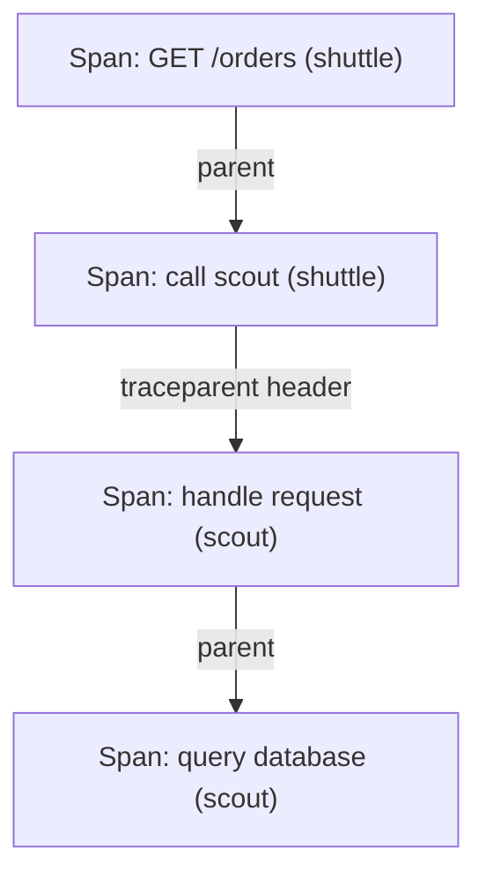

# Metrics, Logs And Traces

A user says that `scout` is slow. The operator needs to know how many users are affected, which request is slow and why it is slow. One kind of data rarely answers all three questions. Metrics, logs and traces are three signal types, and each one is built for a different question.

This chapter looks at each signal in turn: what it records, which properties decide whether it is useful, and where it fails. It ends with the property that limits all three, which is cost. Every extra label, field and span costs storage and money.

## Metrics: numbers over time

A metric is a numerical measurement recorded over time. A single data point has a name, a set of labels (key and value pairs that identify what was measured) and a value. A series is the sequence of values for one name and one label set. Metrics are small and cheap, so a system can record them continuously and answer "how many" and "how often" over any time range.

Prometheus uses four metric types. A counter only increases while the process runs, and resets to zero when the process restarts. A gauge is a value that rises and falls, such as the number of requests in progress. A histogram counts observations into buckets with fixed upper bounds, so a query can estimate percentiles. A summary calculates percentiles inside the application and exposes them directly.

The type decides which calculations are valid. The current value of a counter is not useful, because it depends on when the process started. Instead, a query takes the rate of increase over a time window. Prometheus provides `rate()` for this, and it also handles counter resets. A gauge is read as it is, and a histogram is queried with `histogram_quantile()`.

The `scout` application exposes its metrics over HTTP. Run this to read them from the `shuttle` pod:

<!-- astrona:playground:renew -->

```sh
kubectl -n starfleet exec deploy/shuttle -- curl -s http://scout.starfleet.svc.cluster.local:9898/metrics | grep -E '^# TYPE (http_requests_total|http_request_duration_seconds)'
```

You should see something like:

```text
# TYPE http_requests_total counter
# TYPE http_request_duration_seconds histogram
```

`http_requests_total` is a counter with a `status` label, one series for each HTTP status code that `scout` has returned. `http_request_duration_seconds` is a histogram with the labels `method`, `path` and `status`. The first metric answers "how many requests failed", and the second answers "how long did requests take".

## Logs: events with context

A log is a record of one event with its context. A log line can say that one request to `/status/500` failed at a specific time. A metric cannot say that, because it only keeps the count. Logs explain individual events, but they are larger than metrics, so storing and searching them costs more.

A structured log writes each event as fields, usually JSON, instead of free text. Fields such as `level`, `ts` and `msg` let a tool filter and count events without parsing sentences. A request identifier field lets an operator find every log line that belongs to one request. Podinfo writes structured JSON log lines.

Read the recent `scout` logs:

```sh
kubectl -n starfleet logs deploy/scout --tail=5
```

Each line is one JSON object. The container writes it to standard output, the container runtime stores it on the node, and `kubectl logs` reads it back. The runtime keeps only a limited amount, so a longer retention needs a collector that ships the lines to a log store. Logs can also contain personal data or secrets, so they need access controls and a retention limit.

## Traces: one request across services

A trace records the path of one request through many services. A span is one timed operation inside the trace, for example one HTTP call or one database query. Each span stores a start time, a duration, attributes and the identifier of its parent span. The spans of one trace share a trace identifier, and together they form a tree.

The following diagram shows a trace for one request that passes through two services.



The diagram shows four spans with one trace identifier. The arrow between the two services is context propagation: the caller adds a `traceparent` HTTP header that carries the trace identifier and its own span identifier, and the receiving service reads it and creates a child span. If one service does not forward the header, the trace breaks into two unrelated traces.

Tracing every request is expensive, so systems use sampling. Head sampling decides at the start of a request whether to record the trace, for example one request in a hundred. Tail sampling decides after the trace is complete, so it can keep every slow or failed trace. In both cases a missing trace does not prove that a request did not happen.

## Cardinality: the cost of labels

Cardinality is the number of distinct series a metric produces. Each unique combination of label values is a separate series, and Prometheus keeps every series in memory. The `status` label of `http_requests_total` has a few dozen possible values, which is cheap. A label such as `user_id` or a full URL with a query string can have millions of values, and it can exhaust the memory of the monitoring system.

The rule is to put only bounded values in metric labels. Unbounded identifiers belong in logs and traces, where each record is stored on its own. Count how many series the histogram of `scout` already has:

```sh
kubectl -n starfleet exec deploy/shuttle -- curl -s http://scout.starfleet.svc.cluster.local:9898/metrics | grep -c '^http_request_duration_seconds_bucket'
```

The command prints one number: the count of bucket series. A histogram has one series for each bucket and for each label combination, so a histogram with many labels multiplies the series count quickly. This is why a label must earn its place.

## Choosing a signal from a question

Back to the slow `scout`. A metric, the request duration histogram, shows that the 95th percentile rose after the release and shows how many requests are affected. A trace of a slow request shows that most of its time went into one downstream call. A log line from that service shows the timeout error with the request identifier. The three signals together move from the size of the problem to its cause.

Each signal also fails in its own way. A metric hides which request was slow. A log does not show timing across services. A sampled trace may not exist for the request the user complains about. An average also hides a slow minority, so latency questions use percentiles from histograms.

You now know what each signal records, how the metric types differ, why structured logs and propagated context matter, and why cardinality and sampling limit the data. The open question is how this data leaves the application and reaches a place where it can be queried.

## Common pitfalls

> [!WARNING]
> Do not read a counter's raw value as a rate, and do not put unbounded values such as user identifiers in metric labels. A missing trace or log line can mean sampling, buffering or retention removed it, not that nothing happened.
