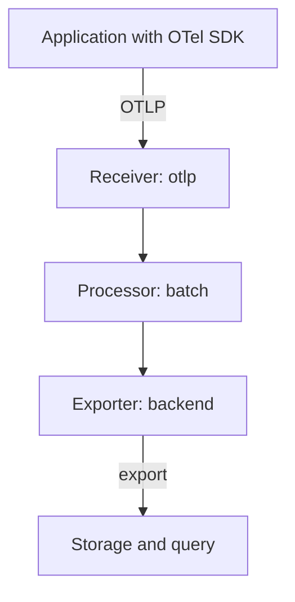

# Instrumentation And Telemetry Pipelines

An application does not become observable by itself. Someone must add code that records measurements, and something must carry those measurements to a system that stores and queries them. If any link in that chain fails silently, the dashboard shows a flat line and the operator may read it as a quiet system. This chapter follows the chain from the code that records a measurement to the query that reads it.

## Instrumentation: OpenTelemetry API, SDK and Collector

Instrumentation is the code that records telemetry. OpenTelemetry (OTel) is a Cloud Native Computing Foundation project that defines one vendor-neutral standard for metrics, logs and traces. It has three main parts, and each has its own job.

The OpenTelemetry API is the set of interfaces that application code calls, for example "start a span" or "add one to a counter". The API does nothing by itself, so libraries can depend on it safely. The SDK is the implementation behind the API. It samples, batches and exports the data, and the application chooses and configures it. The Collector is a separate program that receives telemetry from many applications, processes it and sends it on.

The Collector is built from three kinds of component, joined in a pipeline:

- A receiver accepts data, for example over the OpenTelemetry Protocol (OTLP) on a network port, or by scraping a Prometheus endpoint.
- A processor changes the data in transit: it batches, filters, adds attributes or applies sampling.
- An exporter sends the data to a backend, which is the system that stores it.



The diagram shows one Collector pipeline. The application sends OTLP data to the receiver, the processor changes it, and the exporter delivers it to the storage system. Because the application only talks OTLP to the Collector, changing the backend means changing the exporter, not the application code.

Automatic instrumentation attaches to common libraries and records standard operations, such as incoming HTTP requests, without code changes. Manual instrumentation adds spans and metrics for business operations that no library can know about. Most services use both.

## Pull and push

Telemetry reaches a backend in one of two ways. In the push model, the application sends data to the backend or Collector when it has something to report. In the pull model, the backend contacts the application on a schedule and reads the current values. OpenTelemetry mostly pushes. Prometheus pulls.

Pull has useful properties for monitoring. The monitoring system knows the full list of targets, so a target that does not answer is visible at once: Prometheus records a synthetic metric `up` with value 0 for it. An operator can also read the same endpoint with `curl` to see exactly what Prometheus sees. Push suits short-lived jobs that may finish before a scrape happens.

## The Prometheus scrape mechanism

A target is an endpoint that Prometheus scrapes, normally an HTTP path such as `/metrics`. A scrape is one HTTP GET request to a target. The response is plain text in the Prometheus exposition format: one line for each sample, with the metric name, optional labels and the value.

```text
http_requests_total{status="200"} 42
```

Prometheus reads the file `prometheus.yml`. Its `global` block sets defaults, such as `scrape_interval`, which is how often Prometheus scrapes each target. The `scrape_configs` list holds scrape jobs. A job is a named group of targets that are scraped the same way. Each target gets the labels `job` (the job name) and `instance` (its host and port) automatically.

Look at the configuration that runs in the playground:

<!-- astrona:playground:renew -->

```sh
kubectl -n monitoring get configmap prometheus-config -o jsonpath='{.data.prometheus\.yml}'
```

The file has a `global` block with `scrape_interval` and `evaluation_interval`, a `rule_files` entry that points at `/etc/prometheus/rules/*.yml`, and one job named `prometheus`. That job uses `static_configs`, a fixed list of targets, with one target: Prometheus itself on `localhost:9090`.

A job that scrapes another application looks like this. This snippet is a reference and is not applied:

```yaml
scrape_configs:
  - job_name: probe
    scrape_interval: 10s
    static_configs:
      - targets: ["probe.starfleet.svc.cluster.local:9898"]
        labels:
          env: playground
```

`job_name` becomes the `job` label. A `scrape_interval` inside the job overrides the global value. The `labels` map adds extra labels to every series from those targets. In a real cluster, Prometheus usually discovers targets through Kubernetes service discovery instead of a fixed list, and relabeling rules rewrite or drop target labels before the scrape. Relabeling is a list of rules with `source_labels`, `regex`, `target_label` and `action`, applied to a target's labels.

## From scrape to query

After a scrape, Prometheus stores each sample in its time series database (TSDB) on local disk. Each sample has a timestamp. A query written in PromQL, the Prometheus query language, reads the stored samples through the HTTP API. Query the `up` metric through the API from the `shuttle` pod:

```sh
kubectl -n starfleet exec deploy/shuttle -- curl -s -G http://prometheus.monitoring.svc.cluster.local:9090/api/v1/query --data-urlencode 'query=up'
```

The reply is JSON. Its `data.result` array has one entry for each series, and each entry has the labels `__name__`, `instance` and `job` and a value of `1` when the last scrape succeeded. In the playground only the `prometheus` job exists, so only one series appears. Application metrics such as `http_requests_total{job="scout"}` are not stored, because no job scrapes `scout` yet. Reading `/metrics` with `curl` works, but Prometheus never sees the data until a scrape job lists the target.

## Applying a configuration change

Prometheus reads `prometheus.yml` at startup. To apply a change, you can send a reload request or restart the process. The playground runs Prometheus with `--web.enable-lifecycle`, which enables the `POST /-/reload` endpoint:

```sh
kubectl -n starfleet exec deploy/shuttle -- curl -s -X POST http://prometheus.monitoring.svc.cluster.local:9090/-/reload
```

The command prints nothing when the reload succeeds. If the new file is invalid, Prometheus keeps the old configuration and logs an error. The configuration comes from a ConfigMap, and the kubelet takes up to about a minute to copy a changed ConfigMap into the pod. A reload sent before the copy finishes reads the old file. The reliable alternative is `kubectl -n monitoring rollout restart deploy/prometheus`, which starts a new pod with the current ConfigMap.

You now know the chain: the SDK records, the Collector or a scrape moves the data, the TSDB stores it and PromQL reads it. A scrape job must list a target before its metrics exist in Prometheus. The question that remains is what to do with the data once it is stored.

## Common pitfalls

> [!WARNING]
> A metric that is visible with `curl` is not necessarily in Prometheus: a scrape job must list the target. After editing a ConfigMap, a reload may still read the old file for up to a minute, so restart the Deployment when the change must apply now.
