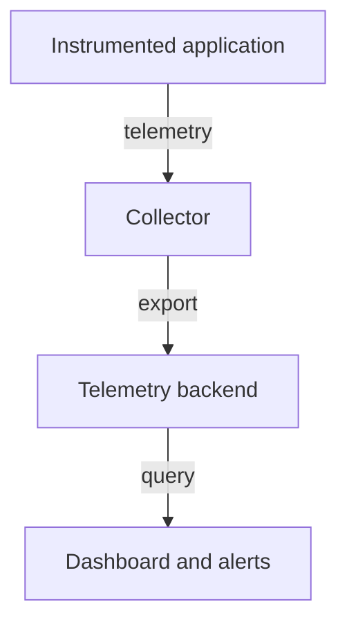

# Instrumentation And Telemetry Pipelines

The `scout` application must emit enough information to diagnose its database calls. Instrumentation adds measurements and context to application code or supporting components. Automatic instrumentation can cover supported libraries; explicit instrumentation can describe application-specific operations that generic tools cannot infer.

Collection moves telemetry from producers to processing and storage systems. A collector may receive, transform, filter and export signals. A backend stores and queries them, while a dashboard visualizes selected results. These are distinct responsibilities even when one product bundles several of them.

OpenTelemetry supplies APIs, software development kits and collection components for producing and moving telemetry. It is not, by itself, the permanent storage and visualization backend for every signal. Prometheus is commonly used for metrics collection, storage and querying. Its typical pull model scrapes exposed metric endpoints.

Producing, transporting, storing and presenting telemetry are separate stages whose failures can hide application behavior.

Metric labels describe dimensions such as route or response category. Unbounded labels, such as a unique customer identifier for every request, can create excessive cardinality: too many distinct time series to store and query economically. Choose dimensions that answer useful questions without turning every event into a separate metric series.

Consistent timestamps, units and attribute names improve comparisons. Collection failures, sampling and retention affect what evidence remains available. A blank dashboard may mean a query or telemetry pipeline failed rather than that the application processed no requests.

Plan observability alongside the application. Select a few useful measurements and request contexts, protect sensitive fields and verify that the information reaches its destination. Installing a collector does not automatically add meaningful instrumentation to every operation.

## Following Telemetry From Producer To Query

The application instrumentation records an operation. A local library or agent sends it to a collector or backend. Processing may add metadata, filter sensitive fields or apply sampling. The backend stores the retained data, and a query selects what the dashboard displays. Each stage can alter or lose information.

If a dashboard is blank, examine whether the application emits the signal, whether collection receives it, whether export succeeds and whether the query matches stored labels and time ranges. Restarting the application is not a universal fix for a backend query or credential problem. The observation pipeline needs its own health evidence.

Prometheus commonly retrieves metrics by scraping endpoints. A reachable application port is not proof that the expected metric endpoint exists or that the collector can access it. Authentication, labels and scrape configuration affect whether measurements become usable series.

## Cardinality Through A Concrete Example

Suppose a request metric uses five route categories and four response classes. That combination can create a manageable set of series. Adding a distinct customer identifier for millions of customers can multiply the number dramatically. Adding a unique request identifier makes the metric act more like individually indexed events, which is generally unsuitable for bounded aggregate measurements.

Detailed request identifiers can belong in logs or trace context where the system is designed to store event-level detail. Metrics should usually use dimensions with controlled value sets that support useful aggregation. The tradeoff is between query detail, operating cost and privacy, not maximum label count.

Standardized attribute names and units make signals easier to compare between services. Retention, sampling and access controls should follow the intended diagnostic use. A useful telemetry design states what is emitted, where it goes, which detail is retained and how operators detect a failure of the collection path itself.

## Common pitfalls

> [!WARNING]
> A collector is not automatically a storage backend. Unbounded metric labels can overwhelm a metrics system, and missing telemetry can indicate a collection failure.
