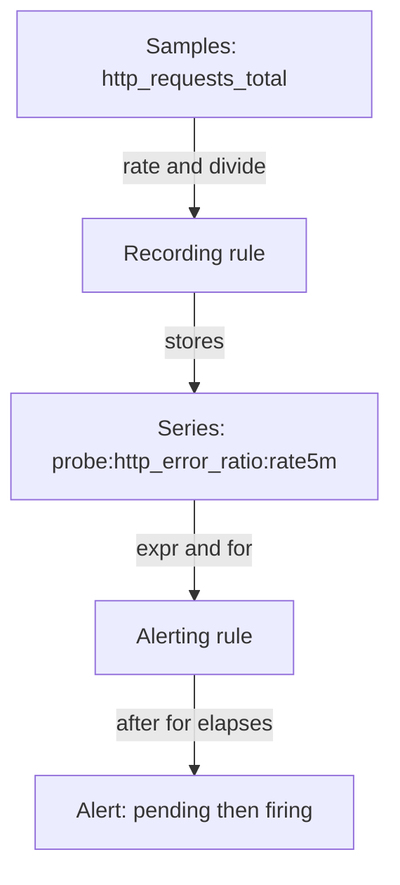

# Service Objectives, Budgets And Alerts

A dashboard full of numbers does not tell a team when to act. Is 99.5% success good? Should an error rate of 2% wake someone at night? Without agreed answers, teams either ignore alerts or chase every spike. Service level objectives turn measurements into targets, and error budgets turn targets into decisions. This chapter defines those terms, does the arithmetic, and then shows how Prometheus rules put the arithmetic into an alert.

## SLI, SLO and SLA

A service level indicator (SLI) is a measurement of one aspect of service behavior, written as a ratio of good events to all valid events. For example, "the fraction of HTTP requests that did not return a 5xx status" is an SLI. A service level objective (SLO) is the target for an SLI over a time window, for example "99.9% of requests succeed, measured over 30 days". A service level agreement (SLA) is a contract with a customer that names consequences, such as credits, if the service misses a level.

The three terms describe three different things: the measurement, the internal target and the external promise. An SLA is normally looser than the SLO, so the team notices a problem before it breaks the contract.

A good SLI counts what users experience. It states which requests are valid, which responses are good and where it is measured. Requests that a client sends wrongly, such as HTTP 400, are usually not counted as failures of the service. Health checks and test traffic are not valid events.

## Error budget arithmetic

The error budget is the amount of failure the SLO allows: 100% minus the SLO. A 99.9% SLO leaves a budget of 0.1%, or 0.001. The budget is a number that the team spends, not a goal to reach. When it runs out, the team slows releases and fixes reliability.

For a time-based view, convert the window to minutes and multiply by the budget. A 30-day window has 30 x 24 x 60 = 43,200 minutes. Check the result:

<!-- astrona:playground:renew -->

```sh
awk 'BEGIN { print 30 * 24 * 60 * (1 - 0.999) }'
```

You should see something like:

```text
43.2
```

A service with a 99.9% SLO may be unavailable for 43.2 minutes, which is 43 minutes and 12 seconds, in 30 days. Stricter targets shrink this fast: 99% allows 432 minutes (7.2 hours), and 99.99% allows 4.32 minutes.

A request-based budget works the same way with counts. For one million valid requests in the window, a 99.9% SLO allows 1,000 failed requests. The two views are not interchangeable: ten minutes of outage fails very different numbers of requests at night and at noon. Choose one definition and keep it.

## Measuring an SLI from counters

The SLI of `scout` comes from the counter `http_requests_total`. Its `status` label separates good from bad. This command adds up all samples, adds up the samples whose status starts with 5, and prints the share of failures since the process started:

```sh
kubectl -n starfleet exec deploy/shuttle -- curl -s http://scout.starfleet.svc.cluster.local:9898/metrics | awk '/^http_requests_total\{/ { total += $2; if ($1 ~ /status="5/) failed += $2 } END { printf "%.4f\n", failed / total }'
```

The result is a number between 0 and 1. In the playground, `shuttle` sends about one failing request in ten, so the value is close to 0.1. That is one hundred times the 0.001 that a 99.9% SLO allows. A cumulative ratio since start is a poor SLI, because it never forgets old traffic. A query over a recent window, built with `rate()`, shows the current behavior.

## Burn rate

Burn rate is how fast the service spends its budget compared with the speed that would use exactly the whole budget over the window. Burn rate 1 spends the budget in exactly 30 days. Burn rate 10 spends it in 3 days. It is the current error ratio divided by the allowed error ratio.

With a 99.9% SLO, the allowed ratio is 0.001. A burn rate of 14.4 means an error ratio of 14.4 x 0.001 = 0.0144. At that rate, one hour spends 14.4 / 720 = 2% of a 30-day budget, because 30 days have 720 hours. The whole budget is gone in 30 / 14.4, or about 2.1 days. Common alert policies use a high burn rate over a short window for a page, and a lower burn rate over a longer window for a ticket.

## Recording and alerting rules

Prometheus evaluates rules at a fixed interval and stores the results. A recording rule saves the result of an expression as a new series. An alerting rule fires when its expression returns data for a given time. Both live in rule files under `groups`, and each group has a `name` and a list of `rules`.



The diagram shows the data flow: the recording rule turns raw counters into a ratio series, and the alerting rule compares that series with a threshold. By convention, a recorded series is named `level:metric:operations`. This reference file, which is not applied, records an error ratio for `probe` and alerts on a 99.5% SLO at burn rate 6:

```yaml
groups:
  - name: probe-slo
    rules:
      - record: probe:http_error_ratio:rate5m
        expr: sum(rate(http_requests_total{job="probe",status=~"5.."}[5m])) / sum(rate(http_requests_total{job="probe"}[5m]))
      - alert: ProbeErrorBudgetBurn
        expr: probe:http_error_ratio:rate5m > 6 * 0.005
        for: 5m
        labels:
          severity: page
        annotations:
          summary: probe is spending its error budget 6 times too fast
```

`record` names the new series. `expr` is the PromQL expression. `for` is how long the expression must keep returning data before the alert changes from pending to firing, which filters short spikes. `labels` attach to the alert and route it, and `annotations` carry human text. Check that the playground Prometheus has no rules yet:

```sh
kubectl -n starfleet exec deploy/shuttle -- curl -s http://prometheus.monitoring.svc.cluster.local:9090/api/v1/rules
```

You should see something like:

```text
{"status":"success","data":{"groups":[]}}
```

## Symptom and cause alerts

A symptom alert watches what the user feels, such as the error ratio or latency of a request. A cause alert watches an internal condition, such as high CPU or a full disk. Pages should come from symptoms, because they state that users are affected now. Causes are better as tickets or dashboard panels, since high CPU may hurt nobody.

Error budget burn is a symptom alert. It fires only when failures are real and large enough to threaten the objective, and it tells the responder how much time remains.

You now know how an SLI becomes an SLO, how the budget and burn rate are computed, and how Prometheus rules turn a ratio into a pending and firing alert. A correct rule still depends on a scrape job that supplies the data, so the two halves of the chain must be built together.

## Common pitfalls

> [!WARNING]
> An alert expression that selects a series which does not exist returns nothing, and Prometheus stays silent. Check that the metric and its labels exist before trusting a rule. Also, do not mix a time-based and a request-based budget in one calculation.
