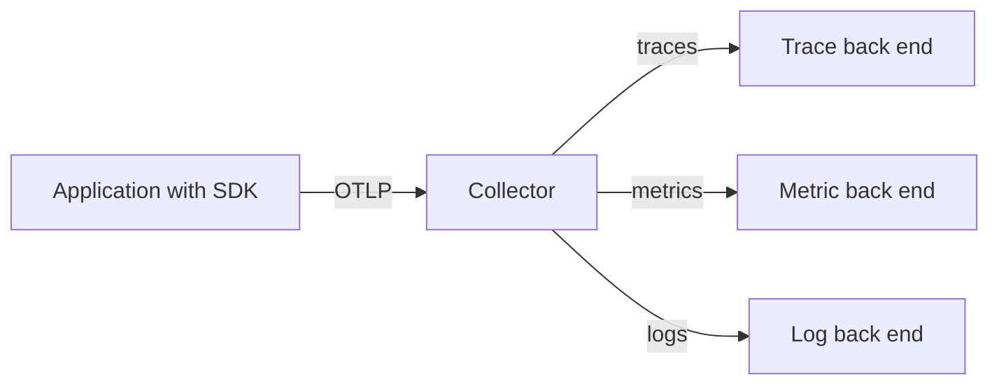

# Signals, Instrumentation And OTLP

Before OpenTelemetry, each monitoring product shipped its own libraries and its own data format. Changing the product meant changing the code of every service. OpenTelemetry (OTel) removes that coupling. It is a Cloud Native Computing Foundation (CNCF) project that defines one set of libraries and one data format for telemetry, so that an application is instrumented once and the data can go to any compatible back end. This part explains the pieces and the standard settings that every OpenTelemetry library reads.

## What OpenTelemetry is and is not

OpenTelemetry is a specification, a set of language libraries, a wire protocol and a data collection program. It produces and moves telemetry. It does not store telemetry and it does not draw dashboards. Storage and queries belong to a back end such as Prometheus for metrics, Jaeger or Tempo for traces and Loki for logs.

The project covers three main signals. A metric is a numeric measurement over time. A trace is the record of one request as it passes through services. A log is a timestamped record of an event. OpenTelemetry also defines how a signal is linked to the others, so a log line can carry the identifier of the trace it belongs to.

## API, SDK and instrumentation

The OpenTelemetry libraries have two layers on purpose. The **API** is a small set of interfaces that application and library code calls to start a span or record a measurement. The API does nothing by itself. The **SDK** is the implementation of the API. It decides how to sample, batch and export the data.

This split lets a library author add instrumentation by using only the API. The application owner then decides, by installing an SDK, whether the data is collected at all. If no SDK is installed, the API calls cost almost nothing.

Instrumentation is the code that creates the telemetry. It comes in two forms:

- **Automatic instrumentation** attaches to common frameworks and clients without a code change. In Java it is an agent attached at start, and in other languages it is a package or a Kubernetes operator that injects it.
- **Manual instrumentation** is code that you write with the API, for a business operation that no framework knows about, such as "calculate price".

Both forms are normally used together. Automatic instrumentation gives the incoming and outgoing request spans, and manual instrumentation adds the spans that carry business meaning.

## OTLP, the wire protocol

The OpenTelemetry Protocol (OTLP) is the standard way to send telemetry from an SDK or a Collector to another component. It carries all three signals. It runs over gRPC, normally on port 4317, or over HTTP, normally on port 4318 with the paths `/v1/traces`, `/v1/metrics` and `/v1/logs`.

Because OTLP is a standard, a back end that accepts OTLP can receive data from any SDK. Many monitoring products now accept OTLP directly, and Prometheus can also receive OTLP metrics when the receiver is enabled.



The diagram shows that the application sends everything in one format to one address, and the Collector decides where each signal goes.

## Resource attributes

Every piece of telemetry says which entity produced it. This description is the **resource**: a set of key-value pairs such as `service.name`, `service.version`, `deployment.environment.name` and, in Kubernetes, `k8s.namespace.name`, `k8s.pod.name` and `k8s.node.name`. The attribute `service.name` is the most important one. A back end groups traces and metrics by it, and without it the data appears as `unknown_service`.

## The standard environment variables

Every OpenTelemetry SDK reads the same environment variables. Operators therefore configure telemetry on a Deployment without a code change. These are the ones to know:

| Variable | What it sets |
| --- | --- |
| `OTEL_SERVICE_NAME` | The value of `service.name` |
| `OTEL_RESOURCE_ATTRIBUTES` | Extra resource attributes, as `key=value` pairs separated by commas |
| `OTEL_EXPORTER_OTLP_ENDPOINT` | Where the SDK sends data, for example `http://collector:4318` |
| `OTEL_EXPORTER_OTLP_PROTOCOL` | `grpc`, `http/protobuf` or `http/json` |
| `OTEL_TRACES_SAMPLER` | The sampler, for example `parentbased_traceidratio` |
| `OTEL_TRACES_SAMPLER_ARG` | The argument of the sampler, for example `0.1` |
| `OTEL_PROPAGATORS` | The propagation formats, by default `tracecontext,baggage` |

<!-- astrona:playground:renew -->

Read the settings of the `scout` Deployment in the playground. At the start it has none:

```sh
kubectl -n starfleet get deployment scout -o jsonpath='{.spec.template.spec.containers[0].env}'
```

The command prints nothing because the container has no `env` field. Set a service name and a resource attribute:

```sh
kubectl -n starfleet set env deployment/scout OTEL_SERVICE_NAME=scout OTEL_RESOURCE_ATTRIBUTES=deployment.environment.name=playground
kubectl -n starfleet rollout status deployment/scout
```

`kubectl set env` changes the pod template, so the Deployment controller starts a new ReplicaSet and replaces the pod. List the variables to confirm:

```sh
kubectl -n starfleet set env deployment/scout --list
```

The `podinfo` image does not read these variables, so the change does not create telemetry. It shows how an operator would configure any application that has an OpenTelemetry SDK, and the same `env` list is what a lab or a Helm chart sets.

## Summing up and what is still open

OpenTelemetry gives one API, one SDK model, one protocol and one set of environment variables for metrics, traces and logs. The application only sends OTLP to one address. The next question is what receives that data, because a Collector in the middle can change, filter and route it before it reaches a back end.

## Common pitfalls

> [!WARNING]
> - **Treating OpenTelemetry as a monitoring product.** It produces and moves telemetry. It does not store it or draw dashboards.
> - **No `service.name`.** The data is grouped under `unknown_service` and cannot be found by service.
> - **Mixing up the ports.** gRPC uses 4317 and HTTP uses 4318. A protocol set to `grpc` against port 4318 fails.
> - **Expecting data from an image without an SDK.** Setting the variables has no effect if the application does not contain an OpenTelemetry SDK or agent.
