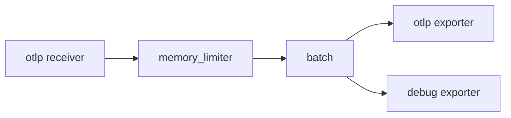

# The Collector And Its Pipelines

An application can send OTLP straight to a back end. At scale this becomes a problem. Every service needs the address and credentials of the back end, a slow back end blocks the exporter in the application, and a change of back end means a change in every service. The OpenTelemetry Collector solves this by sitting between the applications and the back ends. This part explains what the Collector is made of and where to run it.

## What the Collector does

The Collector is a standalone program that receives telemetry, changes it and sends it on. It is vendor neutral and it handles traces, metrics and logs. Because it runs separately from the application, it can buffer data, retry failed sends, remove sensitive attributes and send the same data to more than one back end.

## Receivers, processors, exporters and pipelines

The configuration of the Collector has four building blocks:

- A **receiver** takes data in. It can listen for OTLP, scrape a Prometheus endpoint or read log files.
- A **processor** changes data on its way through. Typical processors batch data, add Kubernetes attributes, drop attributes or limit memory.
- An **exporter** sends data out to a back end or to another Collector.
- A **pipeline** connects receivers, processors and exporters for one signal.

A component is only active when a pipeline under `service` lists it. Defining a receiver without using it in a pipeline does nothing.



The diagram shows one pipeline: data enters through a receiver, passes two processors in the listed order and leaves through two exporters. The order of the processors in the list is the order in which they run.

## A minimal configuration

Save this as `collector-config.yaml`. It receives OTLP, batches data and writes a summary to the Collector's own log with the `debug` exporter:

```yaml
receivers:
  otlp:
    protocols:
      grpc:
        endpoint: 0.0.0.0:4317
      http:
        endpoint: 0.0.0.0:4318

processors:
  batch: {}

exporters:
  debug:
    verbosity: basic

service:
  pipelines:
    traces:
      receivers: [otlp]
      processors: [batch]
      exporters: [debug]
    metrics:
      receivers: [otlp]
      processors: [batch]
      exporters: [debug]
    logs:
      receivers: [otlp]
      processors: [batch]
      exporters: [debug]
```

The pipeline names are the signals: `traces`, `metrics` and `logs`. The same receiver can serve all three, because OTLP carries all three.

## Agent and gateway

There are two common ways to run the Collector in Kubernetes. They are used together in larger systems.

| Pattern | How it runs | Used for |
| --- | --- | --- |
| Agent | A DaemonSet (one pod per node) or a sidecar next to the application | Local collection, adding node and pod attributes, reading node log files |
| Gateway | A Deployment behind a Service, with several replicas | Central processing, tail sampling, credentials for back ends, fan-out |

An agent keeps the path from the application short, so the application hands data over quickly. A gateway concentrates the work that needs a central view. A typical setup sends from the SDK to the agent on the same node, from the agent to the gateway and from the gateway to the back ends.

## Distributions and the Kubernetes attributes

The OpenTelemetry project builds two main Collector distributions. The core distribution has a small set of components. The contrib distribution has many more, including the Kubernetes attributes processor, which adds the namespace, pod and node name to each item. Companies can also build a custom Collector that contains only the components they need.

## Storing the configuration in Kubernetes

In Kubernetes the Collector reads its configuration from a ConfigMap that is mounted as a file. The playground has a ConfigMap named `collector-config` with a sample. Print it:

<!-- astrona:playground:renew -->

```sh
kubectl -n starfleet get configmap collector-config -o jsonpath='{.data.config\.yaml}'
```

Compare the printed file with the example above. Then count the pipelines that the file defines:

```sh
kubectl -n starfleet get configmap collector-config -o jsonpath='{.data.config\.yaml}' | grep -c "^    [a-z]*:$"
```

The command counts lines that have four spaces of indent and a single word followed by a colon. That matches the pipeline names and a few other keys, so treat the number as a hint to read the file and not as a result to trust.

## Summing up and what is still open

The Collector separates the applications from the back ends. Receivers take data in, processors change it, exporters send it out, and pipelines wire them per signal. An agent works close to the application and a gateway works centrally. What remains is the data model that makes a trace possible: how the work of many services is linked into one request.

## Common pitfalls

> [!WARNING]
> - **A component that is not in a pipeline.** It is defined but inactive, and the Collector does not warn in a useful way.
> - **Wrong processor order.** The memory limiter should come first and the batch processor last.
> - **Binding to localhost.** A receiver on `127.0.0.1` is not reachable from other pods. Use `0.0.0.0` in a container.
> - **Using the core distribution and expecting contrib components.** A component that is not compiled in makes the Collector fail at start.
