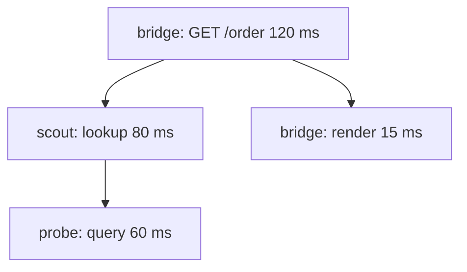

# Distributed Tracing And Sampling

A metric says that checkout got slower. A log says that one service logged an error. Neither shows the path of one slow request across the `bridge`, `scout` and `probe` services. Distributed tracing records that path. This part defines the data model of a trace, explains how the services pass the context to each other and shows how sampling keeps the cost under control.

## Traces and spans

A **trace** is the complete record of one request as it moves through a system. A trace is made of **spans**. A span is one unit of work with a name, a start time, a duration, a status and attributes. A span has a parent, except the first one, which is the root span.

Every trace has a 16-byte **trace ID**, written as 32 hexadecimal characters. Every span has an 8-byte **span ID**, written as 16 hexadecimal characters, and it stores the span ID of its parent. A back end rebuilds the tree from these IDs.



The diagram shows a trace with four spans. The root span took 120 milliseconds. Most of that time was spent in the call to `scout`, and most of the `scout` span was spent in `probe`, so the `probe` query is where to look first.

## Context propagation

Services are separate processes. For `scout` to attach its span to the trace that `bridge` started, `bridge` must pass the trace ID and its own span ID along with the request. This is **context propagation**.

The standard format is the W3C Trace Context. It travels in an HTTP header named `traceparent`:

```text
traceparent: 00-0af7651916cd43dd8448eb211c80319c-b7ad6b7169203331-01
```

The four fields are the version (`00`), the trace ID, the parent span ID and the trace flags. The last flag bit says whether the trace is sampled. The related header `tracestate` carries vendor-specific values. A second mechanism, **baggage**, carries user-defined key-value pairs, such as a customer tier, to every service in the trace.

The instrumentation library does the injecting and extracting. The caller injects the header into the outgoing request and the receiver extracts it from the incoming request. A service that does not pass the header on breaks the trace into two unconnected traces. This is the most common tracing problem.

You can send a trace context by hand from the `shuttle` pod. The `podinfo` application does not trace, but the request shows the header format:

<!-- astrona:playground:renew -->

```sh
kubectl -n starfleet exec deploy/shuttle -- curl -s -o /dev/null -w "%{http_code}\n" -H "traceparent: 00-0af7651916cd43dd8448eb211c80319c-b7ad6b7169203331-01" http://scout/
```

The command prints the HTTP status code. An application that has an SDK would continue this trace and record its spans under the same trace ID.

## Span attributes, events and status

A span carries attributes that follow the **semantic conventions**, a standard list of names so that every service describes the same thing the same way. Examples are `http.request.method`, `http.response.status_code`, `url.path`, `db.system.name` and `server.address`. A span also holds timestamped events, for example an exception, and a status of `Unset`, `Ok` or `Error`.

## Sampling

Recording every trace of a busy system is expensive in network traffic, processing and storage. **Sampling** keeps a fraction of the traces. There are two places to decide.

- **Head sampling** decides when the trace starts, before anyone knows how it will end. It is cheap and simple. The `traceidratio` sampler keeps a fixed fraction of trace IDs, and `parentbased` makes every service follow the decision of the root. The weakness is that the sampler cannot know that a trace will contain an error or be slow, so interesting traces can be discarded.
- **Tail sampling** decides after the trace is complete, usually in a Collector gateway. It can keep every trace that has an error or a latency above a threshold, and a small share of the rest. It needs all spans of a trace to arrive at the same Collector and it needs memory to hold them while it waits.

An SDK setting for head sampling of 10 percent that follows the parent looks like this:

```text
OTEL_TRACES_SAMPLER=parentbased_traceidratio
OTEL_TRACES_SAMPLER_ARG=0.1
```

## Back ends for traces

Jaeger is a CNCF graduated project that stores and visualizes traces. Grafana Tempo is another open source trace store. Both accept OTLP. The user interface shows the span tree and the timing, and searches by service, operation, duration and attributes.

## Summing up and what is still open

A trace is a tree of spans that share a trace ID. Services pass the trace ID and the parent span ID in the `traceparent` header, and a break in propagation splits a trace. Sampling controls the cost, with head sampling that is cheap and tail sampling that keeps the interesting traces. Logs are the third signal, and in Kubernetes they follow rules of their own.

## Common pitfalls

> [!WARNING]
> - **A service that drops the header.** A proxy, queue or custom HTTP client that does not forward `traceparent` splits the trace.
> - **Sampling at 100 percent in production.** Cost grows with traffic. Start with a ratio and keep errors with tail sampling.
> - **Using `traceidratio` without `parentbased`.** Each service then decides on its own, and traces have missing spans.
> - **High-cardinality span names.** Put the user ID or the full URL in an attribute, not in the span name.
