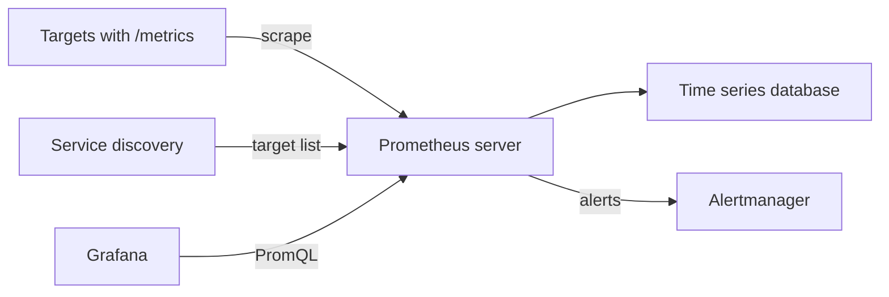

# Architecture And Data Model

A monitoring system has to answer two questions: how does the data get in, and how is it stored so that it can be queried quickly? Prometheus answers the first with a pull model and the second with a time series database in which every series is identified by a metric name and a set of labels. This part explains both, and shows how to check that Prometheus really has your target.

## The pull model

Prometheus **pulls** metrics. At a fixed interval, called the scrape interval, it sends an HTTP GET request to the `/metrics` path of each target and stores the samples that come back. A **target** is an endpoint that exposes metrics. A **scrape job** is a named group of targets with the same settings. The application only has to expose text over HTTP. It does not need to know where Prometheus is.

The pull model has practical advantages. Prometheus knows at once when a target is down, because the scrape fails. A target can be opened with `curl` to see exactly what Prometheus would see. Several Prometheus servers can scrape the same target without any change in the application.

Short-lived jobs that finish before a scrape cannot be pulled. They push their final values to the **Pushgateway**, a small service that holds the values until Prometheus scrapes it.

## The parts of the system



The diagram shows the main flow. Service discovery tells the server which targets exist. The server scrapes them and writes the samples to its local time series database. It sends firing alerts to Alertmanager. Grafana and other clients query the server with PromQL.

In Kubernetes, Prometheus finds targets through the Kubernetes API with `kubernetes_sd_configs`. The role decides what is listed: `node`, `pod`, `service`, `endpoints` or `ingress`. Relabeling rules then decide which discovered targets to keep and which labels to set. The Prometheus Operator adds custom resources such as `ServiceMonitor` and `PodMonitor` that describe the targets, so teams do not edit the main configuration file.

## Time series and labels

A **time series** is a stream of timestamped values that belong to one metric name and one set of labels. A **label** is a key-value pair that splits a metric into dimensions. This is a series of `http_requests_total`:

```text
http_requests_total{job="scout", instance="scout.starfleet:9898", status="200"}
```

Another status code is a different series, and another instance is a different series. Prometheus also adds the labels `job` and `instance` to every scraped series. A **sample** is one value with one timestamp. By default Prometheus keeps its data for 15 days on local disk.

## Cardinality

**Cardinality** is the number of different series that a metric produces. Each unique combination of label values creates a new series that uses memory and disk. A label with a limited set of values, such as the HTTP method, is safe. A label with unbounded values, such as a user ID, an email address or a full URL with parameters, can create millions of series and bring the server down. Choose labels from small, known sets.

## Scrape configuration

The scrape settings live in `prometheus.yml`. Save this as `scrape-scout.yaml` to see the shape of a job:

```yaml
scrape_configs:
  - job_name: scout
    scrape_interval: 15s
    metrics_path: /metrics
    static_configs:
      - targets: ["scout.starfleet.svc.cluster.local:9898"]
```

This is a fragment. The playground ConfigMap `prometheus-config` has the `global` section and a `scrape_configs` list with one job named `prometheus`. Check what Prometheus sees at the start. Run the first query through the `shuttle` pod, because Prometheus has no address outside the cluster:

<!-- astrona:playground:renew -->

```sh
kubectl -n starfleet exec deploy/shuttle -- curl -s -G http://prometheus.monitoring.svc.cluster.local:9090/api/v1/query --data-urlencode 'query=up'
```

The response is JSON. Each result has a `metric` object with the labels and a `value` with a timestamp and the value. The metric `up` is created by Prometheus itself for every target: it is `1` when the last scrape worked and `0` when it failed. At the start the only result is the job `prometheus`. List the targets with their health:

```sh
kubectl -n starfleet exec deploy/shuttle -- curl -s http://prometheus.monitoring.svc.cluster.local:9090/api/v1/targets
```

The `activeTargets` list shows the scrape URL, the labels and the `health` of each target. When a target is down, the field `lastError` holds the reason, for example a connection refused or a timeout.

## Summing up and what is still open

Prometheus pulls text from targets that service discovery or a static list names, stores each labeled series in its local database and marks every target with `up`. Labels give the dimensions, and cardinality limits how many are affordable. The next question is what an application exposes at `/metrics`: the four metric types and the text format.

## Common pitfalls

> [!WARNING]
> - **Expecting Prometheus to receive pushes.** It scrapes. Use the Pushgateway only for short-lived batch jobs.
> - **A target that is missing from the scrape job.** A metric you can see with `curl` is not in Prometheus until a job lists the target.
> - **Labels with unbounded values.** User IDs and full URLs multiply the number of series.
> - **Using Prometheus as long-term storage.** The local database keeps 15 days by default and is not replicated.
