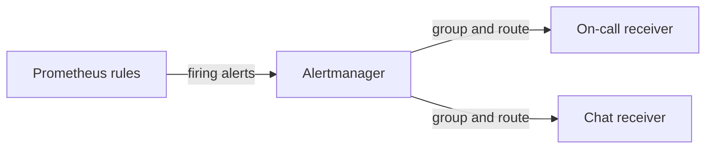

# Alerting, Alertmanager And Dashboards

A query that nobody runs does not help at three in the morning. Alerting turns a query into a notification, and dashboards turn the same queries into a picture for people who investigate. This part explains the division of work between Prometheus, Alertmanager and Grafana, and the settings that decide whether an alert is useful or only noise.

## Recording rules

A **recording rule** evaluates a query on a schedule and saves the result as a new series. It makes dashboards faster, because an expensive query runs once and not on every refresh, and it gives a short name to a long expression. By convention the name has the form `level:metric:operations`:

```yaml
groups:
  - name: scout
    rules:
      - record: job:http_requests:rate5m
        expr: sum by (job) (rate(http_requests_total[5m]))
```

## Alerting rules

An **alerting rule** has an expression and a duration. When the expression returns series, each series becomes an alert. The alert is **pending** while the condition has not lasted for the `for` duration, and **firing** after that. Labels and annotations carry the information for the receiver.

```yaml
groups:
  - name: scout-alerts
    rules:
      - alert: ScoutDown
        expr: up{job="scout"} == 0
        for: 2m
        labels:
          severity: page
        annotations:
          summary: "scout target {{ $labels.instance }} is down"
```

The `for` clause is the main defense against noise. Without it, one failed scrape produces a notification. With `for: 2m`, the condition must hold for two minutes. A rule file is loaded through `rule_files` in the main configuration, and Prometheus reads it again on a reload.

## Alertmanager

Prometheus evaluates the rules but does not send notifications. It sends firing alerts to **Alertmanager**, a separate service that decides who is told, how and when. Its main functions are:

- **Grouping** puts alerts with the same labels, for example the same cluster and alert name, into one notification, so that a failed node does not send a hundred messages.
- **Routing** chooses the receiver from the labels of the alert, with a tree of matchers. An alert with `severity: page` can go to the on-call phone and `severity: ticket` to a chat channel.
- **Inhibition** suppresses an alert when another, more important alert is firing. A "node down" alert can silence the alerts of the pods on that node.
- **Silences** mute alerts that match given labels for a set time, for example during maintenance. A person creates a silence in the interface.
- **Deduplication** merges the identical alerts that several Prometheus servers send.



The diagram shows that Prometheus only evaluates and Alertmanager delivers. The address of Alertmanager is set in the `alerting` section of `prometheus.yml`.

## Alerting on symptoms

Alerts that name causes, such as high CPU on one node, wake people for problems that users never feel. Alerts that name symptoms, such as a high error ratio or high latency measured at the service, tell the team that users are affected. Use causes in dashboards for diagnosis, and use symptoms for pages. Burn-rate alerts on a service level objective follow this rule.

## Grafana

Grafana is an open source tool that draws dashboards. It does not store metrics: it connects to **data sources**, such as Prometheus, Loki and Tempo, and sends them queries. A panel holds one query and a visualization. Dashboards are stored as JSON, so they can be kept in Git and loaded by provisioning. A common setup uses the same PromQL as the rules, and the recording rules make the panels cheap.

## The Prometheus Operator

The Prometheus Operator is a Kubernetes operator that runs Prometheus and Alertmanager from custom resources. A `ServiceMonitor` selects Services and says which port to scrape. A `PodMonitor` selects pods. A `PrometheusRule` holds recording and alerting rules. The operator turns these objects into the Prometheus configuration, so application teams add monitoring with a manifest next to their Deployment. The `kube-prometheus-stack` Helm chart installs the operator, Prometheus, Alertmanager, Grafana, node-exporter and kube-state-metrics together.

## Check the rules in the playground

The playground Prometheus has an API that lists the loaded rules. At the start the list is empty, because the rules file has `groups: []`:

<!-- astrona:playground:renew -->

```sh
kubectl -n starfleet exec deploy/shuttle -- curl -s http://prometheus.monitoring.svc.cluster.local:9090/api/v1/rules
```

After a rule file is loaded, the same endpoint lists each group, the rule type, its health and, for an alert, its state: `inactive`, `pending` or `firing`. The endpoint `/api/v1/alerts` lists the active alerts only.

## Summing up

Recording rules store results of queries. Alerting rules turn a condition that lasts for the `for` duration into a firing alert. Alertmanager groups, routes, inhibits and silences the alerts, and delivers them. Grafana draws dashboards from data sources, and the Prometheus Operator manages the whole stack with custom resources. Together with the signals of the previous module, this is the metrics side of observability that the exam tests.

## Common pitfalls

> [!WARNING]
> - **No `for` clause.** One failed scrape sends a notification.
> - **Thinking Prometheus sends the email.** Alertmanager delivers notifications.
> - **Paging on causes.** CPU at 90 percent on one node is a dashboard item. A rising error ratio is a page.
> - **Confusing a silence with a fix.** A silence only mutes the notification, and the alert still fires.
> - **Expecting Grafana to store metrics.** It queries data sources.
