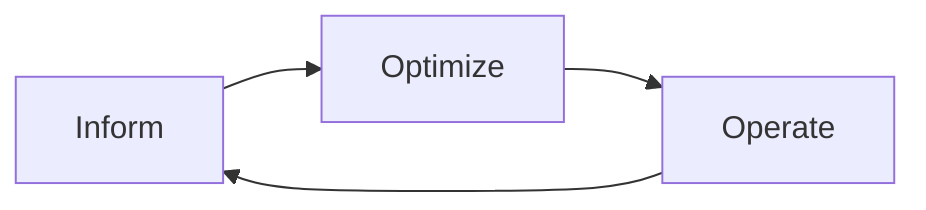

# Cost Drivers And FinOps

Before you can reduce a bill, you must know what it is made of. A cloud bill is a list of resources that exist for some time, and every resource has a price per hour or per gigabyte. This part names the parts of the bill that a Kubernetes cluster produces, explains why the cluster hides them, and introduces FinOps, the practice that engineering, finance and business teams use to control them together.

## What a cluster is billed for

A cloud provider charges for infrastructure that is provisioned, whether or not it is busy. A Kubernetes cluster causes cost in five main places:

- **Compute.** The virtual machines that are the nodes. This is usually the largest part. A node costs the same at 5 percent CPU as at 95 percent.
- **Storage.** The disks behind PersistentVolumes, volume snapshots and container image registries. A disk is billed while it exists, even when no pod uses it.
- **Network.** Traffic that leaves a zone, a region or the cloud (egress). Traffic between zones of one region and traffic to the internet usually costs money, while traffic inside one zone often does not.
- **Load balancers and public addresses.** Each Service of type `LoadBalancer` normally creates one cloud load balancer that is billed by the hour and by traffic.
- **Managed services.** The control plane fee of a managed cluster, and databases, queues and monitoring that the cluster uses. Monitoring itself costs money, because metrics, logs and traces take storage.

## Why Kubernetes hides cost

The cluster is a shared pool. Many teams run many workloads on the same nodes, and the provider's bill shows only the nodes. A team cannot see its own part of the bill without extra work. Resources are also easy to create and easy to forget: a namespace for a test, a PersistentVolumeClaim of 500 GiB, a `LoadBalancer` that no one uses. Elastic infrastructure turns a missing decision into a recurring cost.

Two ideas explain most waste:

1. **Overprovisioning.** A workload requests more CPU and memory than it uses, so the scheduler reserves capacity that stays idle.
2. **Idle resources.** Whole workloads, disks or environments that nobody uses are left running.

## FinOps

FinOps (Financial Operations) is a practice and a culture for managing cloud spend. Its goal is to let teams make trade-offs between speed, quality and cost with shared data. The FinOps Foundation, a project of the Linux Foundation, publishes the framework. It describes three phases that repeat:

| Phase | Question | Activities |
| --- | --- | --- |
| Inform | Where does the money go? | Allocate cost to teams and products, tag resources, build reports and dashboards |
| Optimize | Where can we spend less for the same value? | Right-size, remove idle resources, choose better pricing options |
| Operate | How do we keep it that way? | Set budgets and alerts, review regularly, build cost into the process |

The diagram shows that FinOps is a loop and not a project. New workloads change the picture, so the loop starts again.

FinOps involves several roles. Engineers decide how resources are used. Finance builds forecasts and budgets. Product owners decide what a feature is worth. Platform teams provide the tools and defaults. The practice works when each role sees the same numbers.

## Unit economics

A total bill rises when a business grows, which is not a problem. A better measure is **unit cost**: the cost per request, per customer or per order. If the bill grows by 20 percent while the number of orders grows by 50 percent, efficiency has improved. Reports that show cost next to a business measure help teams to decide.

## Cost as telemetry

Cost can be monitored like latency. A budget with an alert at 80 percent of the monthly limit, a daily report of the biggest namespaces and a graph of cost per request all use the same ideas as service objectives. For this reason cost management belongs with the other observability topics.

## Summing up and what is still open

Compute, storage, network, load balancers and managed services create the bill, and the cluster hides it because teams share nodes and resources are easy to forget. FinOps repeats three phases of inform, optimize and operate. The largest lever is compute, and the resource requests of a pod decide how much compute is reserved. The next part shows how requests, usage and quota work together.

## Common pitfalls

> [!WARNING]
> - **Treating cost as a finance task only.** The people who set requests and create resources are engineers.
> - **Looking at the total only.** A rising bill can be healthy growth. Use unit cost.
> - **Forgetting storage and network.** A disk or a load balancer is billed even when nothing uses it.
> - **One-time clean-up.** Waste returns unless the loop of inform, optimize and operate continues.
