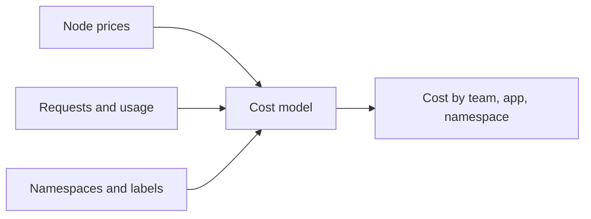

# Allocation, Labels And Cost Tools

A provider bill lists virtual machines. A product manager wants to know what the checkout service costs. Between these two sits cost allocation: the work of splitting the shared bill and assigning each part to a team, product or environment. This part explains how Kubernetes metadata makes allocation possible and what tools such as OpenCost do with it.

## Showback and chargeback

Two models describe what happens after allocation. **Showback** reports the cost to each team without billing it. **Chargeback** transfers the cost to the team's own budget. Showback is the usual first step, because it builds awareness without internal conflict. Chargeback needs allocation that all sides trust.

## Labels as the source of truth

Kubernetes can say who owns a workload only if the objects carry that information. Labels are the standard way. A good set is small and consistent:

| Label | Example | Use |
| --- | --- | --- |
| `team` | `bridge` | Which team owns the workload |
| `cost-center` | `exploration` | Which budget pays for it |
| `app.kubernetes.io/name` | `scout` | Which application it belongs to |
| `env` | `production` | The environment |

Put the labels on the namespace and on the workload. A namespace label is the simplest way to allocate: if a team owns a namespace, the cost of everything in it belongs to the team. Labels on pods allow finer splitting inside a shared namespace. Save this as `namespace-starfleet.yaml`:

```yaml
apiVersion: v1
kind: Namespace
metadata:
  name: starfleet
  labels:
    team: bridge
    cost-center: exploration
```

Apply it and list the labels:

<!-- astrona:playground:renew -->

```sh
kubectl apply -f namespace-starfleet.yaml
kubectl get namespace starfleet --show-labels
```

The first command may print a warning that the namespace was created without the `kubectl apply` annotation. The warning is harmless and the labels are set. Policy tools such as Kyverno or ValidatingAdmissionPolicy can then require the labels, so that a Deployment without a `team` label is rejected.

## How a cost tool calculates

A cost tool joins three sources of data:

1. **Prices.** The hourly price of each node type from the cloud provider's pricing information, or a custom price list on premises.
2. **Resource data.** The requests and the actual usage of each container, from the Kubernetes API and from metrics.
3. **Metadata.** Namespaces, labels and annotations.

For each pod it takes the node price, assigns a share of the node by the larger of the request and the usage of CPU and memory, and adds storage and network. Summing the pods by a label gives the cost of a team. The cost of capacity that no pod reserves is the **idle** cost. **Shared** costs, such as the control plane, monitoring and ingress controllers, can be spread evenly or in proportion to use.



The diagram shows the cost model: three inputs go in, and the output is cost by any label that you choose.

## OpenCost and Kubecost

**OpenCost** is a CNCF project that provides a vendor-neutral specification and an open source implementation for measuring and allocating Kubernetes cost in real time. It runs in the cluster, reads Kubernetes and Prometheus data and exposes the results as an API, a user interface and Prometheus metrics. **Kubecost** is a commercial product built on OpenCost that adds features such as long retention and multi-cluster views. Cloud providers also offer their own views of cluster cost, which use the provider's tags.

Because OpenCost exposes Prometheus metrics, its cost numbers can use the same alerting rules and dashboards as every other metric. For example, an alert can fire when the daily cost of a namespace rises by more than 30 percent.

## What to look for in a report

- **Idle cost.** The share of node cost that no workload reserves. A high share means nodes are too many or too large.
- **Efficiency.** Usage divided by request. A low value means overprovisioned requests.
- **Top namespaces and workloads.** A few items usually hold most of the cost.
- **Orphans.** Unattached disks, unused load balancers and namespaces without an owner label.
- **Trend.** Cost per day and cost per unit of business, not the monthly total alone.

## Summing up and what is still open

Allocation turns one bill into cost per team. It depends on consistent labels on namespaces and workloads. Cost tools such as OpenCost join prices, requests, usage and metadata to compute cost, idle cost and efficiency, and they expose the results as metrics. Knowing where the money goes leads to the question of how to pay less: through different purchase options and through scaling.

## Common pitfalls

> [!WARNING]
> - **Inconsistent labels.** `team`, `Team` and `owner` split one team into three lines in the report.
> - **Labels only on pods.** Cost for storage and load balancers needs labels on those objects too.
> - **Ignoring idle cost.** It belongs to nobody unless the platform team decides how to share it.
> - **Starting with chargeback.** Teams distrust numbers they have never seen in showback.
