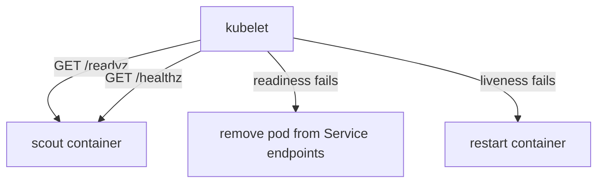

# Boundaries, Resilience And Elasticity

Users reach the `scout` application through one Kubernetes Service. If the one pod behind that Service crashes, users see errors until a new pod starts. If a node is drained for maintenance, the same thing happens. This part explains the design rules and the Kubernetes settings that remove that weakness. It starts with how an application is divided into parts, and then it hardens one workload.

## Loose coupling and microservices

**Coupling** describes how much one part of a system must know about another. In a tightly coupled system, a caller depends on the internal details of the callee: its location, its data layout, its release schedule. In a **loosely coupled** system, the caller depends only on a stable interface, such as an HTTP API with a documented contract. The callee can change its internals, move to another node or scale to ten copies, and the caller does not notice.

A **microservice** is a small service that owns one business capability and its data, and exposes it through a network API. An application built from microservices has several of these, each with its own release cycle. The Cloud Native Computing Foundation (CNCF) definition of cloud native names microservices, containers and declarative APIs as typical building blocks, because they make loose coupling practical.

Microservices have costs, and the exam expects you to name both sides:

- Benefit: a team can release, scale and fix one service without touching the others.
- Benefit: a failure can stay inside one service when callers use timeouts and fallbacks.
- Cost: every call between services is a network call that can be slow, fail or time out.
- Cost: data that was one database transaction becomes several services, so consistency needs extra work.
- Cost: more services means more deployments, more monitoring and more version compatibility to manage.

A service boundary is a good one when the two sides change for different reasons and rarely change together. A boundary is a bad one when every feature needs a coordinated release of three services. Splitting early, without that evidence, only adds network calls.

## What makes a workload replaceable

Kubernetes treats a pod as disposable. A Deployment controller creates replacement pods when pods disappear, and it never repairs a pod in place. This only works when four conditions hold:

1. Any copy can answer any request, so there is no copy that holds special data.
2. A new copy starts from the container image and a configuration source, with no manual step.
3. The platform can tell whether a copy is healthy and ready for traffic.
4. Several copies exist, so the loss of one does not stop the service.

The next sections turn each condition into a setting.

## Replicas and the Deployment controller

The `replicas` field of a Deployment sets how many pods the controller keeps running. The Deployment owns a ReplicaSet, and the ReplicaSet creates pods until the count matches. When a pod is deleted or its node fails, the ReplicaSet notices the difference and creates a new pod. One replica means any pod loss is an outage. Three replicas mean the service continues while one is replaced.

Look at the starting state of `scout`:

<!-- astrona:playground:renew -->

```sh
kubectl -n starfleet get deployment scout
kubectl -n starfleet get pods -l app=scout
```

The Deployment reports one ready replica. Now delete the pod and watch the ReplicaSet replace it:

```sh
kubectl -n starfleet delete pod -l app=scout
kubectl -n starfleet get pods -l app=scout --watch
```

A new pod with a new name appears within seconds. During the gap, the `scout` Service has no endpoint, so a request fails. The watch ends when you press Ctrl+C. The replacement happened without any person, but the outage did not disappear. Only more replicas close the gap.

## Health probes

A running container is not always a working application. A process can be alive while it waits on a dead database connection. A **probe** is a check that the kubelet, the node agent that runs the containers, repeats against a container. Kubernetes has three kinds, and each one triggers a different action:

| Probe | The kubelet asks | When it fails |
| --- | --- | --- |
| `startupProbe` | Has the application finished starting? | The kubelet restarts the container. Other probes wait until it passes |
| `readinessProbe` | Can the application take traffic now? | The pod is removed from Service endpoints. The container is not restarted |
| `livenessProbe` | Is the application stuck? | The kubelet restarts the container |

A probe can run an HTTP GET, open a TCP connection or execute a command in the container. The `podinfo` application serves `/healthz` for liveness and `/readyz` for readiness on port 9898. A probe also has timing fields: `initialDelaySeconds`, `periodSeconds`, `timeoutSeconds` and `failureThreshold`. The container counts as failed only after `failureThreshold` failures in a row.



The diagram shows that the kubelet runs both probes against the same container, and that a failed readiness probe changes traffic while a failed liveness probe restarts the process.

Use a liveness probe only for a state that a restart can repair. A liveness probe that checks a database makes every pod restart when the database is down, and the restarts add load to a system that is already failing.

## Graceful termination and disruption budgets

When Kubernetes stops a pod, it sends the signal `SIGTERM` to the main process and waits `terminationGracePeriodSeconds` (30 seconds by default) before it sends `SIGKILL`. A good application finishes its current requests when it receives `SIGTERM`. The pod is also removed from Service endpoints at the same time, but removal and signal are not perfectly ordered, so applications often wait a few seconds before they exit.

Voluntary disruptions, such as `kubectl drain` during node maintenance, remove pods on purpose. A **PodDisruptionBudget** (PDB) limits how many pods of one application the eviction API may remove at once. Its field `minAvailable` sets how many pods must stay up. A `maxUnavailable` field expresses the same limit from the other side. The PDB applies only to voluntary evictions. It does not stop a node crash, and it does not stop a person who deletes pods directly.

A PDB with `minAvailable: 2` on three replicas lets a drain evict one pod at a time. A PDB on a single replica with `minAvailable: 1` blocks the drain completely, which is a common cause of a stuck node upgrade.

## Resource requests, limits and elasticity

The scheduler places a pod on a node that has enough free capacity for the pod's **resource requests**. A request is the amount of CPU or memory that the container is promised. A **limit** is the maximum the container may use. Memory above the limit kills the container with an out-of-memory error, and CPU above the limit is throttled. A pod without requests can be placed on a full node and then starve.

**Elasticity** means the number of running copies follows the load. The Horizontal Pod Autoscaler changes `replicas` for you, and it computes utilization as a percentage of the CPU request. A workload without a request cannot be scaled on CPU percentage at all. Requests are therefore part of resilience and also a prerequisite for automatic scaling.

## Configuration and state outside the container

A container image is the same on every node, so it must not contain settings that differ between environments. A **ConfigMap** is a Kubernetes object that stores configuration as key-value pairs. A pod reads it as environment variables or as files. Changing the ConfigMap changes the next pod that starts, and the image stays the same.

Durable data does not belong in the container's writable layer, because the layer disappears with the pod. Data goes to a database, an object store or a persistent volume. The application instance then holds nothing that cannot be rebuilt, and any copy can answer any request. This is what **stateless** means for a workload: the instance keeps no data that must survive its replacement. It does not mean the system has no state.

Save this as `scout-config.yaml`:

```yaml
apiVersion: v1
kind: ConfigMap
metadata:
  name: scout-settings
  namespace: starfleet
data:
  PODINFO_UI_MESSAGE: "served by a replaceable pod"
```

Apply it:

```sh
kubectl apply -f scout-config.yaml
```

Then check the result:

```sh
kubectl -n starfleet get configmap scout-settings -o jsonpath='{.data}'
```

The ConfigMap exists on its own. A Deployment can now read the key with `envFrom` and a `configMapRef`, and the same image runs with different settings in each namespace.

## Putting the settings together

A hardened Deployment has several replicas, both probes, resource requests, a PDB and configuration from a ConfigMap. Each setting answers one failure: a lost pod, a stuck process, a node drain, a crowded node and a changed environment. None of them replaces the others. Probes without replicas still leave an outage while the single pod restarts. Replicas without a PDB can all be evicted by one drain.

## Common pitfalls

> [!WARNING]
> - **Using one probe for both jobs.** A failing readiness probe only removes the pod from traffic. A failing liveness probe restarts the container. Use `/readyz` for readiness and `/healthz` for liveness.
> - **A liveness probe on a dependency.** If the probe checks a database, a database outage restarts every pod.
> - **A PDB that blocks everything.** `minAvailable` equal to the replica count means no voluntary eviction can ever succeed.
> - **Calling a pod stateless when it writes files.** Data written to the container's file system is lost when the pod is replaced.
> - **No resource requests.** The scheduler cannot place the pod well, and CPU-based autoscaling has no base value.
