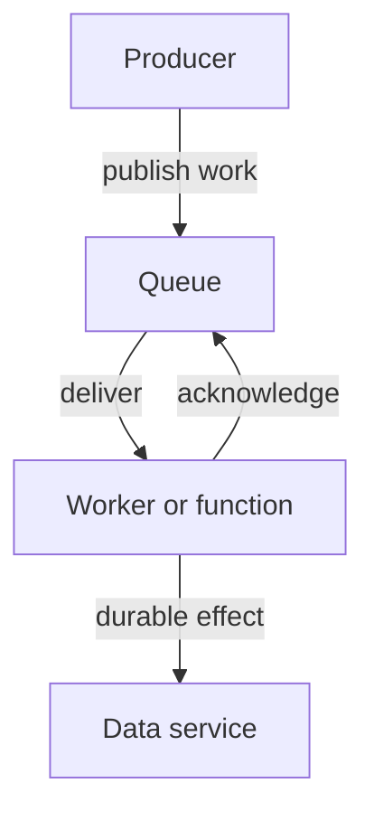

# Serverless And Event-Driven Workloads

A new report request enters a queue, and a worker processes it later. Event-driven design lets producers publish occurrences or work without requiring the consumer to finish synchronously. An event describes something that happened; a work message can request an operation. The distinction helps clarify who owns the resulting action.

Asynchronous delivery introduces its own contract. Messages can be delayed, duplicated or reordered depending on the system and configuration. Acknowledgment tells the delivery system that work has reached its expected stage, but application effects and acknowledgment can fail at different times. Idempotent handling makes repeated delivery safer.

A queue can absorb a burst, but it does not create processing capacity. Monitor backlog and processing latency. If consumers cannot keep up indefinitely, the system needs additional capacity, admission control or a reduced workload. A durable backlog is useful only if the business can tolerate its delay.

Serverless shifts infrastructure provisioning and scaling responsibilities toward a platform. Functions are one common execution model, but serverless also includes other managed services. Servers still exist; the application owner manages fewer of their details. Execution limits, startup latency, permissions and cost models still matter.

Asynchronous processing separates publication from completion and requires safe handling of delivery and application effects.

Choose asynchronous work when callers can tolerate deferred completion and when buffering helps the workflow. Choose a synchronous interface when a caller needs an immediate result and the dependency contract supports it. Serverless can implement either pattern, but it does not eliminate the need for explicit failure handling.

## Message Delivery And Durable Effects

A worker receives a report request, writes the result and then acknowledges the message. If it stops between writing and acknowledgment, the message can be delivered again. A repeated attempt should recognize the same logical work and avoid an unwanted duplicate effect. The delivery system and external storage do not automatically share one transaction.

Acknowledging before the effect is durable creates a different risk: the delivery system considers work complete while the report can still be lost. The correct ordering and recovery mechanism depend on the application, storage and messaging guarantees. A stable work identifier can support deduplication and explicit completion records.

Ordering also matters. A later update can arrive before an earlier one under some delivery contracts. A consumer may need sequence checks, version comparisons or operations designed to commute safely. The word “event-driven” does not establish one universal ordering guarantee.

## Backlog, Scaling And Execution Limits

A queue depth metric shows pending work, while processing latency shows how long users wait. A growing backlog means arrivals exceed completed work over time. Scaling workers can help if the workload is parallelizable and the downstream systems have capacity. Otherwise it can increase contention without reducing completion delay.

Serverless functions can provide automatic instance management, but execution duration, concurrency, startup behavior and cost boundaries still apply. A task that exceeds a platform's duration limit may need another design, such as a durable workflow or a separately managed worker. Platform automation does not remove that compatibility requirement.

Choose synchronous or asynchronous behavior from the caller's needs. An immediate confirmation can acknowledge accepted work without claiming it is already complete, but the interface must communicate that distinction. Durable progress, safe repetition and observable completion make deferred processing a reliable contract rather than merely moving failure out of the initial request.

## Common pitfalls

> [!WARNING]
> Serverless still uses servers and has operating constraints. A queue does not guarantee exactly-once application effects or unlimited processing capacity.
