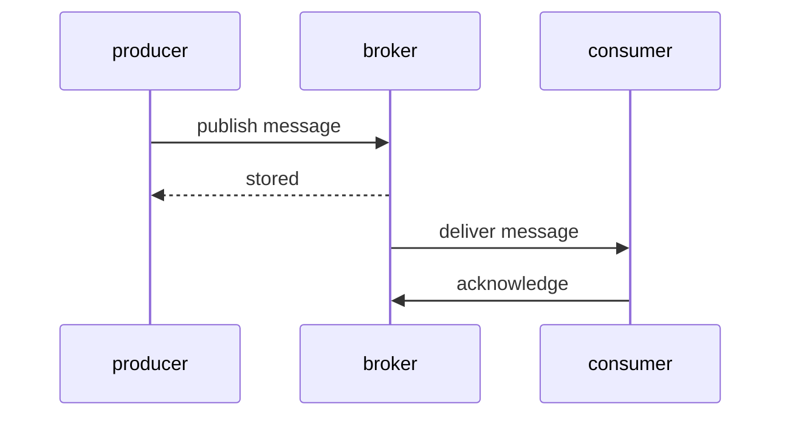

# Serverless And Event-Driven Workloads

A report request arrives at 02:00, a file lands in a storage bucket, a payment service publishes "order paid". None of these needs a process that runs all day. Serverless platforms and event-driven designs run code only when there is work, and they raise questions that an always-on web service does not: what starts the code, what happens when the work fails halfway, and what happens when the same message arrives twice. This part answers those questions and ends with the Kubernetes objects that run finite work.

## What serverless means

**Serverless** is an operating model in which the platform provisions, scales and bills the execution environment, and the developer supplies only code or a container image. Servers still exist. The difference is who manages them. The developer does not choose node sizes, patch operating systems or decide how many copies run.

Two common forms exist. **Function as a Service** (FaaS) runs one function per event, such as an HTTP request or a file upload, and bills by execution time. **Serverless containers** run an ordinary container image and scale it from request volume. In the Kubernetes ecosystem, Knative Serving provides the second form: it routes requests to pods, scales their number from request load and can scale to zero.

**Scale to zero** means the platform stops all copies of a workload when no requests arrive. It removes idle cost. The price is a **cold start**: the first request after idle time must wait while the platform schedules a pod, pulls the image if needed, starts the process and passes the readiness check. A cold start can take from under a second to many seconds, depending on image size and application start time.

Serverless fits work that is bursty, event-driven and short. It fits poorly when a workload needs steady low latency, long-running connections, local state or special hardware. The developer still owns application correctness, permissions, secrets and the limits the platform sets, such as the maximum run time of one invocation.

## Events, messages and brokers

An **event** is a record that something happened, for example "order 1001 was paid". A **message** is any unit of data sent through a messaging system, and it can be an event or a request for work. The sender is the **producer**, and the receiver is the **consumer**. A **broker** is a service that accepts messages from producers, stores them and delivers them to consumers. A **queue** holds messages until one consumer takes each of them.

Between producer and consumer, the broker removes the need for both to be running at the same time. The producer finishes as soon as the broker stores the message. This is **asynchronous** communication. It gives three benefits: the producer does not wait, a burst of messages waits in the queue instead of overloading the consumer, and the consumer can fail and restart without losing work.

CloudEvents is a CNCF specification for the common fields of an event, such as its type, source and identifier. A shared format lets different systems exchange events without custom conversion.



The diagram shows that the producer is finished when the broker confirms storage, and that the broker removes the message only after the consumer acknowledges it.

## Delivery guarantees

A message can be lost or repeated because the network, the broker or the consumer can fail at any point. Brokers describe their behavior with three terms:

- **At-most-once**: the broker delivers a message once and never retries. A failure can lose the message.
- **At-least-once**: the broker retries until the consumer acknowledges. A failure after processing but before the acknowledgment makes the broker deliver the message again, so the consumer can process it twice.
- **Exactly-once**: each message has exactly one effect. A broker alone cannot guarantee this across a network failure. Systems that claim it combine at-least-once delivery with deduplication, often inside one system boundary.

Most production brokers default to at-least-once, because losing work is usually worse than repeating it. That choice moves a duty to the consumer: it must handle duplicates.

## Retries and idempotency

A **retry** repeats a failed operation. Retries are safe for transient failures such as a timeout, and they need limits: a maximum number of attempts and a growing delay between attempts, called **backoff**. Without limits, many clients retrying at once can overload a service that is already struggling. A message that fails every attempt goes to a **dead-letter queue**, where a person or another process inspects it later.

An operation is **idempotent** when running it several times has the same effect as running it once. Setting a value is idempotent. Adding 10 to a balance is not. Many operations are not idempotent by nature, so the sender attaches an **idempotency key**, a unique identifier for the logical operation, for example `evt-1001`. The receiver stores the keys it has processed. When a request arrives with a known key, the receiver returns the stored result and does not repeat the effect.

Retries, at-least-once delivery and idempotency work as one set. Retries recover from failures, at-least-once delivery means duplicates happen, and idempotency makes the duplicates harmless.

## Running finite work in Kubernetes

A Deployment keeps pods running forever. Work that must finish needs a different object. A **Job** creates one or more pods and tracks them until a required number complete successfully. Four fields control how a Job fails and ends:

| Field | What it does |
| --- | --- |
| `backoffLimit` | The number of retries before the Job is marked failed. The default is 6 |
| `restartPolicy` | `Never` makes the Job controller create a new pod for each retry. `OnFailure` restarts the container in the same pod. A Job cannot use `Always` |
| `activeDeadlineSeconds` | The maximum run time of the whole Job. When it is reached, Kubernetes stops the pods and marks the Job failed |
| `ttlSecondsAfterFinished` | Deletes the finished Job and its pods after this many seconds |

The Job controller waits longer between each retry, with an increasing delay. A **CronJob** creates a Job on a schedule written in cron syntax. Its `concurrencyPolicy` decides what happens when the previous run is still active: `Allow` starts another, `Forbid` skips the new run, and `Replace` stops the old run. The field `startingDeadlineSeconds` limits how late a missed run may still start.

Create a Job whose command always fails, to see the retry limit work:

<!-- astrona:playground:renew -->

Save this as `job-always-fails.yaml`:

```yaml
apiVersion: batch/v1
kind: Job
metadata:
  name: always-fails
  namespace: starfleet
spec:
  backoffLimit: 2
  activeDeadlineSeconds: 120
  template:
    spec:
      restartPolicy: Never
      containers:
        - name: worker
          image: curlimages/curl:8.22.0
          command: ["sh", "-c", "echo attempt; exit 1"]
```

Apply it:

```sh
kubectl apply -f job-always-fails.yaml
```

Then check the result:

```sh
kubectl -n starfleet get pods -l job-name=always-fails
kubectl -n starfleet get job always-fails -o jsonpath='{.status.conditions[*].reason}'
```

The Job controller creates a new pod after each failure. When `backoffLimit` is used up, the Job gets the condition reason `BackoffLimitExceeded`, and no further pods start. The delay between retries grows, so the final state can take a minute or more to appear. This is the Kubernetes version of a bounded retry: a failing task stops by itself and leaves its pods for inspection.

## Summing up and what is still open

Serverless moves infrastructure work to the platform, and scale to zero trades idle cost for cold starts. Event-driven designs decouple producer and consumer through a broker, and at-least-once delivery means every consumer must tolerate duplicates through idempotency keys. A Job gives finite work bounded retries, and a CronJob gives it a schedule. What remains is to set these fields for a real task, so that retries finish and duplicates cause no second effect.

## Common pitfalls

> [!WARNING]
> - **Saying serverless has no servers.** Servers exist. The platform operates them.
> - **Assuming exactly-once delivery.** Design the consumer for at-least-once delivery.
> - **Retrying without a limit or a delay.** Set `backoffLimit` and a deadline, or a broken task retries forever.
> - **A Job with `restartPolicy: Always`.** The API server rejects it. Use `Never` or `OnFailure`.
> - **A CronJob with overlapping runs.** `Allow` is the default. Use `Forbid` when two runs must not work on the same data.
