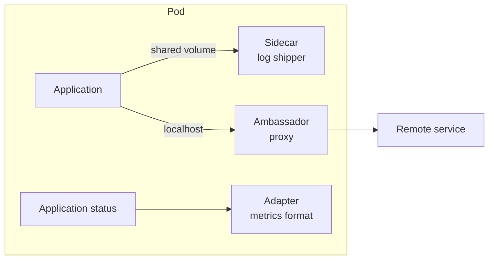

# Container Design Patterns

A pod can hold more than one container. The containers share the network namespace and can share volumes, so they are a single unit of deployment. Several patterns use this to add behavior without changing the main application.

## Init containers

An **init container** runs to completion before the application containers start. Init containers run one after another, and each must succeed. Use them for set-up work: wait for a dependency, fetch a file, prepare a volume or run a migration. They can use a different image from the application, so the application image stays small.

## The sidecar pattern

A **sidecar** is a container that runs next to the main container for the whole life of the pod and extends it. Typical sidecars ship logs, refresh credentials, run a proxy for a service mesh or sync content from a repository. Since Kubernetes 1.29 (stable in 1.33) a sidecar can be declared as an init container with `restartPolicy: Always`. Such a container starts before the main container and keeps running, and it is stopped after the main containers during shutdown.

## The ambassador pattern

An **ambassador** is a container that acts as a proxy for the application towards the outside. The application talks to `localhost`, and the ambassador handles the connection to a remote service, for example to pick a shard of a database or to add retries. The application stays simple.

## The adapter pattern

An **adapter** changes the output of the application into the format the platform expects. A common case is a container that reads the application's own status output and exposes it as Prometheus metrics.



## Shared resources in a pod

Containers in one pod reach each other on `localhost` and can mount the same volume, for example an `emptyDir`, which lives as long as the pod. They share the pod's IP address, so two containers cannot listen on the same port.

## Try a sidecar

Save this as `pod-sidecar-test.yaml`. The first container writes a line every 5 seconds to a shared volume. The second one reads the file and prints it, as a log shipper would:

<!-- astrona:playground:renew -->

```yaml
apiVersion: v1
kind: Pod
metadata:
  name: sidecar-test
  namespace: starfleet
spec:
  volumes:
    - name: shared
      emptyDir: {}
  initContainers:
    - name: prepare
      image: curlimages/curl:8.22.0
      command: ["sh", "-c", "echo started > /shared/app.log"]
      volumeMounts:
        - name: shared
          mountPath: /shared
  containers:
    - name: writer
      image: curlimages/curl:8.22.0
      command: ["sh", "-c", "while true; do date >> /shared/app.log; sleep 5; done"]
      volumeMounts:
        - name: shared
          mountPath: /shared
    - name: shipper
      image: curlimages/curl:8.22.0
      command: ["sh", "-c", "tail -F /shared/app.log"]
      volumeMounts:
        - name: shared
          mountPath: /shared
```

Apply it and read the log of the shipper:

```sh
kubectl apply -f pod-sidecar-test.yaml
kubectl -n starfleet wait --for=condition=Ready pod/sidecar-test --timeout=120s
kubectl -n starfleet logs sidecar-test -c shipper --tail=3
```

The log shows the line from the init container and the dates written by the writer. Delete the pod with `kubectl -n starfleet delete pod sidecar-test` after the exercise.

## Common pitfalls

> [!WARNING]
> - **Putting unrelated applications in one pod.** Containers in a pod scale and restart together.
> - **Forgetting `-c` in `kubectl logs`.** In a pod with several containers the command needs a container name.
> - **Expecting an init container to keep running.** It must finish for the pod to start.
> - **Two containers on the same port.** They share one network namespace.
