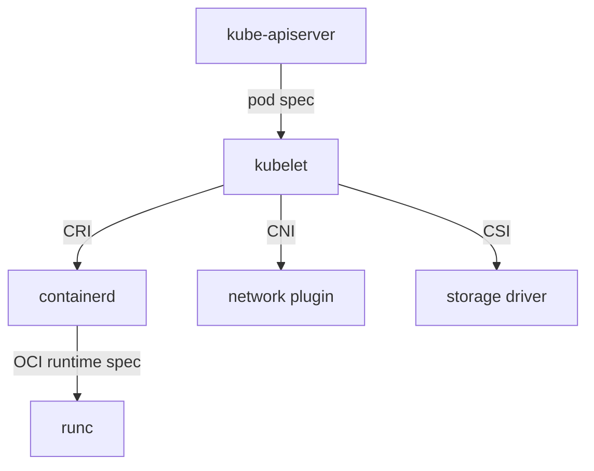

# Standards And Implementation Boundaries

A team runs its cluster on one container runtime today and wants to try another next year. If Kubernetes were built around one runtime, that change would mean rewriting parts of the platform. It is not, because Kubernetes talks to the runtime through a defined interface. This part explains the main interfaces and standards, shows where each one sits when a pod starts, and then separates three words that the exam uses with exact meanings: specification, implementation and managed service.

## Why open standards matter

An **open standard** is a public specification that anyone can implement and that a neutral organization maintains. It has two practical effects. First, **interoperability**: software written by different teams works together because both follow the same contract. Second, **portability**: a workload or a component can move to another environment or product with little change. Without a standard, each pair of products needs custom integration work, and a customer who adopts one product is tied to it.

The CNCF (Cloud Native Computing Foundation) hosts many projects, but it does not define every standard. Some standards come from other bodies, such as the Open Container Initiative (OCI) under the Linux Foundation. Kubernetes defines several interfaces itself and maintains them as part of the project.

## The standards a pod start passes through

When you create a pod, several components act in order. Each boundary between two components is an interface.



The diagram shows the kubelet as the single caller: it uses CRI for containers, CNI for pod networking and CSI for volumes, and the container runtime uses an OCI runtime to create the Linux process.

The next sections define each interface.

### OCI: images and runtimes

The **Open Container Initiative** (OCI) publishes three specifications. The **image specification** defines how a container image is laid out: a manifest, a configuration and a list of filesystem layers, each identified by a digest. The **runtime specification** defines how a low-level runtime turns an unpacked image and a configuration file into a running isolated process. The **distribution specification** defines the HTTP API that registries use to push and pull images. An image built by any OCI-compliant tool can run on any OCI-compliant runtime and be stored on any OCI-compliant registry. `runc` is the reference implementation of the runtime specification.

### CRI: the kubelet to the container runtime

The **Container Runtime Interface** (CRI) is a gRPC API, a binary remote-procedure-call protocol, that the kubelet uses to manage pod sandboxes and containers. It has calls for pulling images, creating a sandbox, starting a container and reading status. A runtime that implements CRI, such as **containerd** or **CRI-O**, works with the kubelet. The kubelet does not know which product is behind the socket. Docker Engine does not implement CRI itself. Kubernetes removed its built-in Docker support in version 1.24, and a cluster that wants to run Docker-built images uses containerd, because those images follow the OCI image format.

### CNI: pod networking

The **Container Network Interface** (CNI) defines how a runtime asks a plugin to attach a container to a network. The plugin is an executable. When a pod sandbox starts, the runtime calls the plugin with an `ADD` command, and the plugin creates the network interface, assigns an IP address and sets up routes. On deletion, the runtime calls `DEL`. Calico, Cilium, Flannel and the `kind` default plugin are CNI implementations. Kubernetes requires that every pod can reach every other pod without address translation, and the plugin provides that.

### CSI: storage

The **Container Storage Interface** (CSI) defines how a storage system exposes volumes to a container orchestrator. A CSI driver runs as pods in the cluster. When a PersistentVolumeClaim needs a new volume, a provisioner component in the driver calls the storage system and creates it. The kubelet then asks the driver to attach and mount the volume. A **StorageClass** names the provisioner and its parameters, so a claim can ask for a class by name.

## Seeing the interfaces on a cluster

Each interface leaves a trace that `kubectl` can read. First, list the nodes with extra columns:

<!-- astrona:playground:renew -->

```sh
kubectl get nodes -o wide
```

The `CONTAINER-RUNTIME` column shows the runtime that the kubelet reports through CRI, including its version. The `kind` playground uses containerd. To read just that value, use a JSONPath expression:

```sh
kubectl get nodes -o jsonpath='{.items[0].status.nodeInfo.containerRuntimeVersion}'
```

The value has the form `<runtime>://<version>`. Next, list the StorageClasses. The `PROVISIONER` column names the CSI driver or other provisioner that creates volumes for each class, and the class marked `(default)` serves claims that name no class:

```sh
kubectl get storageclass
```

Finally, list the pods in `kube-system` and look for the network plugin and the DNS service:

```sh
kubectl -n kube-system get pods
```

Each name is an implementation of one of the interfaces above or a core Kubernetes component. The runtime and the network plugin run as processes on the node or as pods, and Kubernetes finds them through the interface, not through special code.

## Specification, implementation and managed service

These three words are easy to confuse.

- A **specification** is a written contract that describes behavior. OCI image specification, CRI and CNI are specifications. A specification contains no running code.
- An **implementation** is software that follows a specification. containerd, CRI-O and runc implement CRI or the OCI runtime specification. Many implementations of one specification can exist, and they can differ in speed, features and extra options.
- A **managed service** is an implementation, or a whole platform, that a provider operates for a customer. Managed Kubernetes services run the control plane for the customer. Managed container registries, databases and message brokers work the same way.

A managed service takes operating work off the customer, such as upgrades, backups and availability. It can also add provider-specific features and interfaces. A workload that uses only the open interface can move to another provider. A workload that uses a provider-only feature has a switching cost, even when the underlying engine is open source.

When a question asks how to avoid lock-in, look for the answer that depends on the open interface and not on one product. When a question asks how to reduce operating work, a managed service is the answer, and the cost is some control.

## Summing up and what is still open

You can now follow a pod from the API server to a running process and name the interface at each step, and you can read the runtime and the storage provisioner from a live cluster. You can also say whether a name refers to a contract, to software or to a service that someone else operates. The open question is how to choose among the many projects that implement or build on these interfaces, and how those projects add new objects to Kubernetes itself.

## Common pitfalls

> [!WARNING]
> - **Treating Docker and containerd as the same thing.** Kubernetes talks to a CRI runtime. Images built with Docker still run, because they follow the OCI image format.
> - **Calling a CNI plugin a Kubernetes component.** Kubernetes requires pod networking but does not ship the plugin.
> - **Assuming a managed service is portable by default.** Check which features use only the open interface.
> - **Mixing up CRI and OCI.** CRI is the kubelet-to-runtime API. OCI defines images and the low-level runtime.
