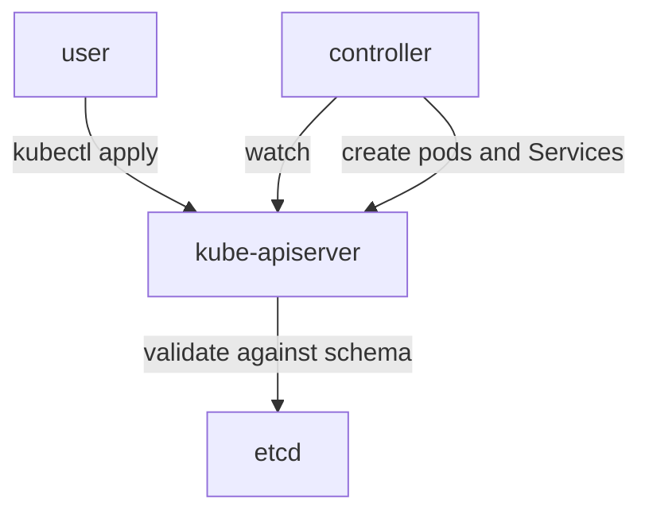

# Matching Projects To Platform Jobs

The CNCF landscape lists hundreds of projects and products. A team that must collect metrics, route traffic or enforce a policy does not need to know all of them. It needs a way to name the job, find the category and compare the options in that category against its own requirements. This part gives that method. It then explains the extension mechanism that most projects use to add their own objects to Kubernetes, and it creates one such object so the mechanism is visible.

## From a job to a category

A **platform job** is a task that every cluster-based platform must do. Each job has a category, and each category has several projects. The table lists representative projects. It is a teaching list, not a ranking, and it does not claim a current maturity level for any project, because levels change.

| Platform job | Category | Representative projects |
| --- | --- | --- |
| Run containers on a node | Container runtime | containerd, CRI-O |
| Connect pods and enforce network rules | Networking (CNI) | Cilium, Calico, Flannel |
| Provide volumes and storage | Storage | Rook, Longhorn, CSI drivers of cloud providers |
| Collect metrics and alert | Observability | Prometheus |
| Create standard telemetry | Observability | OpenTelemetry |
| Trace requests across services | Observability | Jaeger |
| Collect and forward logs | Observability | Fluent Bit, Fluentd |
| Deliver changes from Git to the cluster | Continuous delivery | Argo CD, Flux |
| Encrypt and control traffic between services | Service mesh | Istio, Linkerd |
| Validate or change objects at admission | Policy | Kyverno, Open Policy Agent Gatekeeper |
| Package and install applications | Application definition | Helm |
| Scale on external events | Autoscaling | KEDA |
| Route external traffic into the cluster | Ingress and API gateway | Envoy-based gateways, Gateway API implementations |
| Store and serve container images | Registry | Harbor |
| Exchange events | Messaging and eventing | NATS, Knative Eventing, CloudEvents format |

Read the table as a lookup: when a question describes a job in plain words, name the category first and the projects second. A question about "a tool that scrapes metrics from pods and stores them as time series" describes Prometheus. A question about "a tool that makes a cluster match a Git repository" describes a GitOps controller such as Argo CD or Flux.

## Choosing from requirements and constraints

Several projects in one category can do the same job. The choice depends on requirements and constraints, and the order matters.

1. State the requirement in one sentence. For example: "we must encrypt all traffic between services without changing application code".
2. List the constraints: team size, skills the team already has, the cost of running the tool, support expectations, the Kubernetes version and the other tools in the platform.
3. Check that the candidates satisfy the requirement in full. Remove the ones that do not.
4. Compare the rest against the constraints. A small team with no service-mesh experience may prefer the smaller tool. A team with strict policy rules may prefer the tool with finer controls.

A project's CNCF maturity level shows how the project is governed and adopted. It does not say whether the project fits a requirement. A graduated project can be a poor fit, and a sandbox project can be exactly right for a narrow job. The level is one input.

## How projects extend Kubernetes

Most of the projects above do more than run next to Kubernetes. They add their own object types to the Kubernetes API, so a user manages them with the same `kubectl` commands and the same access control. Kubernetes supports this through three parts.

A **CustomResourceDefinition** (CRD) is a Kubernetes object that declares a new resource kind: its API group, its name, its scope and the schema of its fields. After the API server accepts a CRD, it serves the new kind like a built-in kind. A **custom resource** (CR) is an object of that new kind. The API server stores it in etcd, the cluster's key-value database, and returns it on request.

A custom resource does nothing by itself. A **controller** is a program that watches objects of one kind and acts until the real state matches the desired state in the object. This loop is called **reconciliation**. A controller plus its custom resources is the **operator pattern**: it encodes operating knowledge, such as how to install, upgrade and back up an application, as software that reads declared objects.



The diagram shows that the user and the controller both talk only to the API server. The API server validates the object against the schema from the CRD before it stores it, and the controller reacts to the stored object.

A second mechanism, **API aggregation**, lets another server handle a whole API group behind the main API server. Metrics Server uses it to serve the `metrics.k8s.io` API. A CRD is the simpler option and is enough for most projects.

## Creating a custom resource type

Create a small CRD for a `Sensor` kind. The schema requires a `target` string and an `intervalSeconds` integer that is at least 1 and defaults to 30. The CRD name must be the plural resource name, a dot and the group.

<!-- astrona:playground:renew -->

Save this as `crd-sensor.yaml`:

```yaml
apiVersion: apiextensions.k8s.io/v1
kind: CustomResourceDefinition
metadata:
  name: sensors.fleet.example.com
spec:
  group: fleet.example.com
  scope: Namespaced
  names:
    plural: sensors
    singular: sensor
    kind: Sensor
  versions:
    - name: v1
      served: true
      storage: true
      schema:
        openAPIV3Schema:
          type: object
          properties:
            spec:
              type: object
              required: ["target"]
              properties:
                target:
                  type: string
                intervalSeconds:
                  type: integer
                  minimum: 1
                  default: 30
```

Apply it:

```sh
kubectl apply -f crd-sensor.yaml
```

Then check the result:

```sh
kubectl get crd sensors.fleet.example.com
kubectl api-resources --api-group=fleet.example.com
```

The new kind now appears in the API. Create one custom resource, leaving out `intervalSeconds` so the API server fills in the default. Save this as `sensor-scout.yaml`:

```yaml
apiVersion: fleet.example.com/v1
kind: Sensor
metadata:
  name: scout-sensor
  namespace: starfleet
spec:
  target: scout
```

Apply it:

```sh
kubectl apply -f sensor-scout.yaml
```

Then check the result, and try an invalid value with a server-side dry run, which sends the request to the API server and stores nothing:

```sh
kubectl -n starfleet get sensor scout-sensor -o jsonpath='{.spec}'
kubectl -n starfleet create --dry-run=server -o yaml -f - <<'YAML'
apiVersion: fleet.example.com/v1
kind: Sensor
metadata:
  name: bad-sensor
spec:
  target: scout
  intervalSeconds: 0
YAML
```

The first command shows `intervalSeconds` set to 30 by the default. The second command fails: the API server compares the object with the schema and rejects the value 0 because the schema says the minimum is 1. No controller is installed, so the `Sensor` object only stores data. A controller for this kind would be the next step.

## Summing up and what is still open

You can now match a platform job to a category and name representative projects, choose among them from requirements and constraints, and explain how a project adds objects to the Kubernetes API with a CRD, a schema and a controller. The open question is what the cluster does with the stored objects, which is the work of the controller that a project ships.

## Common pitfalls

> [!WARNING]
> - **Choosing by maturity level alone.** The level describes governance and adoption, not fit for a requirement.
> - **Expecting a custom resource to act.** Without a controller, the object is only stored.
> - **Wrong CRD name.** `metadata.name` must be `<plural>.<group>`, or the API server rejects the CRD.
> - **A schema that is not structural.** Every field needs a `type`, or the API server rejects the CRD.
> - **Treating the table as a ranking.** It lists examples of jobs, not the best tool.
