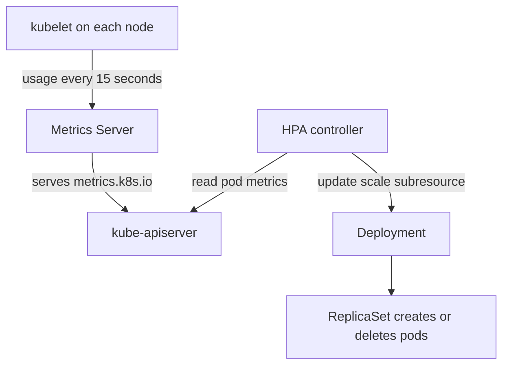

# The Horizontal Pod Autoscaler

A Deployment with `replicas: 2` keeps two pods whether the load is ten requests per minute or ten thousand. The Horizontal Pod Autoscaler (HPA) is the Kubernetes controller that changes that number for you. This part explains where the HPA gets its numbers, how it turns them into a replica count and what it needs from your workload before it can work at all.

## The metrics pipeline

The HPA does not measure anything itself. It asks the Kubernetes API for metric values. Three kinds of metric exist, and each one is served by a different API:

| Metric type | API group | Served by | Example |
| --- | --- | --- | --- |
| Resource | `metrics.k8s.io` | Metrics Server | CPU or memory of a pod |
| Custom | `custom.metrics.k8s.io` | A metrics adapter | Requests per second per pod |
| External | `external.metrics.k8s.io` | A metrics adapter | Length of a queue outside the cluster |

**Metrics Server** is a cluster add-on that collects CPU and memory usage from the kubelet on every node and serves it through the aggregated API `metrics.k8s.io`. It keeps only the latest values in memory and it is not a monitoring system. The command `kubectl top` reads the same API.



The diagram shows that the HPA controller only reads from and writes to the API server. The Deployment controller and ReplicaSet do the actual work of creating and deleting pods.

## The scaling formula

The HPA controller runs a loop, by default every 15 seconds. In each pass it computes the desired replica count with this formula:

```text
desiredReplicas = ceil( currentReplicas * currentMetricValue / desiredMetricValue )
```

For a utilization target, the metric value is the average over all pods of usage divided by the container's request, as a percentage. Suppose 4 pods each request 100m of CPU, and each uses 180m. The utilization is 180 percent. With a target of 60 percent, the desired count is ceil(4 * 180 / 60) = 12. If `maxReplicas` is 10, the HPA sets 10 and records that scaling was limited.

The formula has three guards. First, a **tolerance** of 10 percent: if the ratio of current to desired is between 0.9 and 1.1, the HPA does nothing, which prevents small changes from causing churn. Second, the result is clamped between `minReplicas` and `maxReplicas`. Third, pods that are not ready, or that have no metrics yet, are treated with care so that a start-up spike does not cause extra scale-up.

## Why a request is required

Percent utilization needs a denominator. Kubernetes uses the container's CPU **request** for it, not its limit and not the node capacity. If any container in a pod has no CPU request, the pod's utilization is undefined and the HPA takes no action for that metric. The HPA reports this in its conditions as a failure to compute the metric.

This is the most common reason for an HPA that never scales. Setting requests is therefore part of making a workload scalable, and the request value also changes the behavior: a request of 100m with a 60 percent target scales out when average usage passes 60m per pod.

## The HPA object

The current API version is `autoscaling/v2`. The object names a target through `scaleTargetRef`, sets the bounds, and lists metrics. The target must support the scale subresource, which Deployments, StatefulSets and ReplicaSets do.

```yaml
apiVersion: autoscaling/v2
kind: HorizontalPodAutoscaler
metadata:
  name: scout
  namespace: starfleet
spec:
  scaleTargetRef:
    apiVersion: apps/v1
    kind: Deployment
    name: scout
  minReplicas: 1
  maxReplicas: 4
  metrics:
    - type: Resource
      resource:
        name: cpu
        target:
          type: Utilization
          averageUtilization: 50
```

When an HPA controls a Deployment, remove `replicas` from the Deployment manifest that you keep in version control. Otherwise each `kubectl apply` resets the count and fights the HPA.

## Creating an HPA

Check that the metrics API works and that `scout` has a request:

<!-- astrona:playground:renew -->

```sh
kubectl top nodes
kubectl -n starfleet get deployment scout -o jsonpath='{.spec.template.spec.containers[0].resources}'
```

`kubectl top nodes` prints CPU and memory for the node. Metrics Server needs about a minute after the cluster starts, so retry if the first call reports that metrics are not available yet. The second command prints a request of 100m CPU.

Save the HPA above as `hpa-scout.yaml`.

Apply it:

```sh
kubectl apply -f hpa-scout.yaml
```

Then check the result:

```sh
kubectl -n starfleet get hpa scout
kubectl -n starfleet describe hpa scout
```

The `TARGETS` column shows the current utilization against the target, for example a small percentage over 50 percent. At first it can show `<unknown>` until the first metric arrives. In `describe`, the conditions `AbleToScale` and `ScalingActive` explain what the controller can do, and `ScalingLimited` shows when the result was clamped by `minReplicas` or `maxReplicas`. An idle `scout` stays at one replica, which is `minReplicas`.

## Summing up and what is still open

The HPA is a loop that reads metrics from the API server, applies one formula and writes a new replica count. It needs Metrics Server for CPU and memory, a CPU request on every container, and a target that supports scaling. What remains is the other two directions of scaling, because more replicas need room on nodes and sometimes a larger pod is the better answer.

## Common pitfalls

> [!WARNING]
> - **No CPU request.** The HPA cannot compute utilization and never scales. The condition `ScalingActive` is false.
> - **Metrics Server is missing or unhealthy.** `kubectl top` fails, and the HPA reports that it cannot get metrics.
> - **Keeping `replicas` in the applied Deployment.** Each apply resets the count that the HPA chose.
> - **Reading the target as a limit.** Utilization is relative to the request, so a pod can exceed 100 percent.
> - **Expecting instant scale-up.** The loop runs every 15 seconds, and new pods need time to start and become ready.
