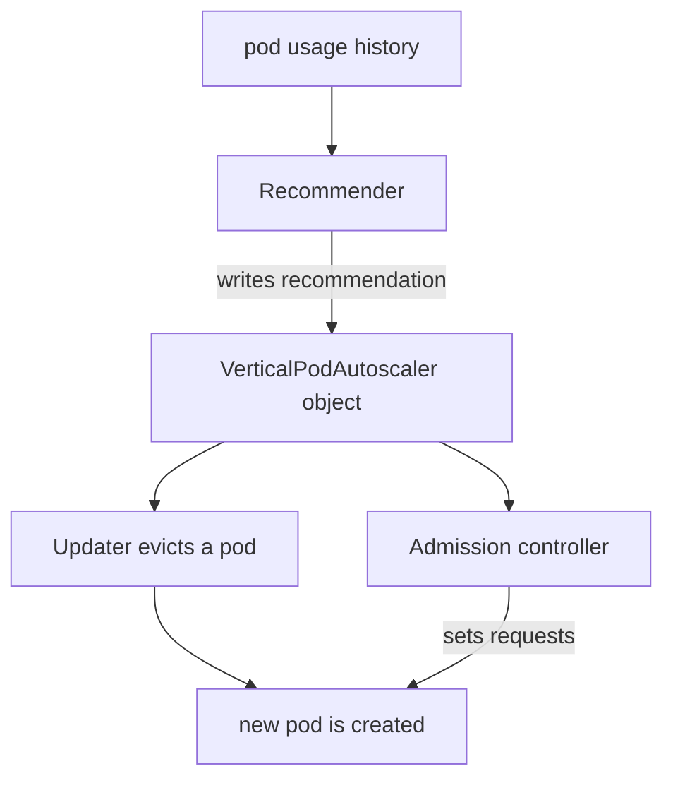

# Vertical And Cluster Scaling

More replicas do not help every workload. A database primary cannot be copied, a batch job may need more memory on one pod, and a new replica is useless when no node has room to run it. This part explains the two other directions of scaling: changing the size of a pod and changing the number of nodes. It also shows how resource requests connect all three directions.

## Requests decide placement

The scheduler places a pod on a node whose unreserved capacity covers the pod's **requests**. The scheduler adds up the requests of the pods on a node, not their real usage. A node with 2 CPU cores can hold twenty pods that each request 100m, even if they are all idle, and it cannot hold a twenty-first. The amount of a node that the scheduler may hand out is the **allocatable** capacity, which is smaller than the raw capacity because the system reserves part of it.

Look at the allocation on the playground node:

<!-- astrona:playground:renew -->

```sh
kubectl describe node | grep -A 8 "Allocated resources"
kubectl top pods -n starfleet
```

The first command prints the sum of requests and limits as a percentage of allocatable. The second prints real usage. The two numbers usually differ: requests are a reservation, and usage is a measurement. A large gap means the requests are too high and capacity is wasted. A request below real usage means the node can be overcommitted, and pods can be throttled or evicted under pressure.

## Vertical Pod Autoscaler

The **Vertical Pod Autoscaler** (VPA) changes the requests of a pod's containers. It is a Kubernetes autoscaling project that is not part of the core control plane. You install it separately, and it adds a custom resource, `VerticalPodAutoscaler`. It has three components:

| Component | Job |
| --- | --- |
| Recommender | Reads usage history and computes recommended requests |
| Updater | Evicts pods whose requests differ too much from the recommendation |
| Admission controller | Changes the requests of new pods as they are created |

The `updatePolicy.updateMode` field decides what the VPA does with a recommendation:

| Mode | Behavior |
| --- | --- |
| `Off` | Only computes and shows recommendations |
| `Initial` | Sets requests when a pod is created and never changes a running pod |
| `Recreate` | Also evicts running pods so they restart with new requests |
| `Auto` | Currently the same as `Recreate`, and can use in-place resize where the cluster supports it |



The diagram shows that the Recommender only writes a recommendation, and the other two components apply it when a pod is created or replaced.

A vertical change usually restarts the pod, because a running container historically could not change its resources. The `Off` mode is therefore a safe way to learn the right requests for a workload without any restart. A VPA and an HPA must not both act on CPU for the same workload, because the VPA changes the denominator that the HPA uses. The common pattern is an HPA on CPU and a VPA in `Off` mode for advice, or a VPA on memory only.

## Cluster scaling

When the HPA creates pods that no node can fit, the pods stay in the `Pending` state with the event `FailedScheduling`. A **cluster autoscaler** watches for exactly this state. It asks the infrastructure provider for another node, and it removes nodes that stay mostly empty and whose pods can move elsewhere. The Kubernetes Cluster Autoscaler and Karpenter are two projects that do this. A kind cluster has one fixed node, so no cluster autoscaler runs in the playground.

This links the directions. A pod request is the unit in which the cluster autoscaler counts demand: it adds a node when pending pods have requests that no current node can satisfy. Requests that are too large add nodes that are not needed, and requests that are too small pack too many pods on a node.

## Choosing the direction

| Situation | Direction | Reason |
| --- | --- | --- |
| Stateless web service with variable traffic | Horizontal | Each replica can answer any request |
| Single instance that cannot be copied | Vertical | Only a bigger instance helps |
| Requests are guesses | Vertical in `Off` mode | Gives measured recommendations |
| Pods stay pending because nodes are full | Cluster | Adds node capacity |
| Work depends on a queue or schedule | Event-driven | Scale from the signal that predicts load |

## Reading a VPA recommendation

A recommendation has a lower bound, a target and an upper bound for each container. Use the target as the new request. The lower bound is the least that is safe, and the upper bound is the most the recommender expects to be needed. Because the recommender uses history, a new workload with a few minutes of data produces a poor recommendation. Collect data over a representative period, such as a full day, before you trust it.

## A worked example

A container requests 500m of CPU and 512Mi of memory, and the VPA target is 120m of CPU and 200Mi of memory. The container reserves four times more CPU than it needs and more than twice the memory it needs. On a node with 2000m allocatable, the scheduler fits four such pods by CPU. With the target requests, it would fit sixteen. The same hardware carries four times as many replicas, which gives the HPA room to scale out before the cluster autoscaler must add a node.

The opposite case is a container that requests 50m and regularly uses 300m. The scheduler places many such pods on one node, and when they peak together the node runs out of CPU and the pods are throttled. A request should sit close to typical usage, and a limit should sit above the peak.

## Summing up and what is still open

Requests are the number that the scheduler, the HPA and the cluster autoscaler all use. The VPA improves that number, the HPA changes how many pods carry the load, and a cluster autoscaler adds nodes when the pods do not fit. What remains is scaling on signals other than CPU, and controlling how fast the HPA changes the count.

## Common pitfalls

> [!WARNING]
> - **Using VPA and HPA on CPU for the same workload.** They change each other's input and can oscillate.
> - **Assuming usage decides placement.** The scheduler uses requests, so an idle pod still takes room.
> - **Trusting a recommendation from a young workload.** The recommender needs history.
> - **Expecting nodes to appear in kind.** The playground has one node, so pending pods stay pending.
> - **Setting requests far above usage.** The cluster is full on paper and empty in practice.
