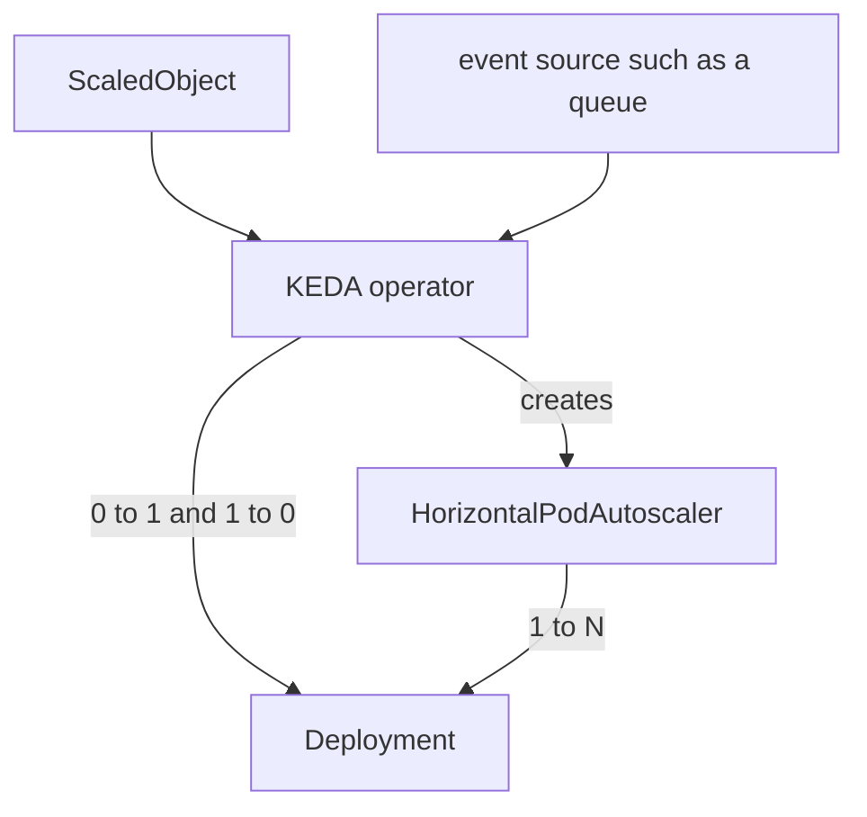

# Event-Driven Scaling And Scaling Behavior

CPU is a late signal. By the time CPU rises on a worker, the queue it reads has already grown, and a worker that waits for messages can sit idle at 0 percent CPU while hundreds of messages wait. Some workloads therefore need scaling from a different signal, and every autoscaler needs rules about how fast it may change the count. This part covers both.

## KEDA

**KEDA** (Kubernetes Event-driven Autoscaling) is a CNCF project that scales workloads from external event sources. You install it in the cluster. It adds custom resources, mainly `ScaledObject` for Deployments and `ScaledJob` for Jobs. It does not replace the HPA. It works with it:

1. A KEDA operator watches each `ScaledObject`.
2. A KEDA metrics adapter exposes the trigger values to the API server as external metrics.
3. KEDA creates and manages a normal HorizontalPodAutoscaler for the target.
4. KEDA itself handles the change between zero and one replica, because the HPA cannot scale to zero by itself.



The diagram shows that KEDA owns the move between zero and one replica, and a generated HPA handles the range from one up to the maximum.

A trigger names a source and a threshold. KEDA has scalers for many sources, such as message queues, streams, databases, Prometheus queries and a cron schedule. A `ScaledObject` for a worker might look like this. The fields are `scaleTargetRef`, `minReplicaCount`, `maxReplicaCount` and a list of `triggers`:

```yaml
apiVersion: keda.sh/v1alpha1
kind: ScaledObject
metadata:
  name: beacon-worker
  namespace: orbit
spec:
  scaleTargetRef:
    name: beacon-worker
  minReplicaCount: 0
  maxReplicaCount: 10
  triggers:
    - type: cron
      metadata:
        timezone: UTC
        start: 0 8 * * *
        end: 0 18 * * *
        desiredReplicas: "3"
```

This object is shown for reading only, because the playground does not install KEDA. It keeps three replicas from 08:00 to 18:00 UTC and none outside that window. With `minReplicaCount: 0`, the application must accept a cold start: the first event waits until a pod starts.

## Why scaling can oscillate

Load changes in bursts. An HPA that follows each sample would add pods during a burst, remove them seconds later and add them again. Each new pod costs start-up time and cache warm-up. The HPA has the `behavior` field to damp this.

## The behavior field

`behavior` has separate `scaleUp` and `scaleDown` sections. Each section can set:

| Field | Meaning |
| --- | --- |
| `stabilizationWindowSeconds` | The autoscaler looks back over this period and uses the most conservative recommendation. Default is 0 for scale-up and 300 for scale-down |
| `policies` | Limits on the change per period. Each has `type` (`Pods` or `Percent`), `value` and `periodSeconds` |
| `selectPolicy` | Which policy wins when several apply: `Max` (default), `Min` or `Disabled` |

For scale-down, the controller uses the highest replica recommendation seen during the window. If the load drops for one minute and returns, the count never fell. A policy such as `Percent` 50 per 60 seconds limits how many pods can leave in one minute.

## Applying a behavior

Patch the HPA from the previous part so it scales down slowly and scales up by at most two pods per 30 seconds.

<!-- astrona:playground:renew -->

Save this as `hpa-scout.yaml`:

```yaml
apiVersion: autoscaling/v2
kind: HorizontalPodAutoscaler
metadata:
  name: scout
  namespace: starfleet
spec:
  scaleTargetRef:
    apiVersion: apps/v1
    kind: Deployment
    name: scout
  minReplicas: 1
  maxReplicas: 5
  metrics:
    - type: Resource
      resource:
        name: cpu
        target:
          type: Utilization
          averageUtilization: 50
  behavior:
    scaleUp:
      stabilizationWindowSeconds: 0
      policies:
        - type: Pods
          value: 2
          periodSeconds: 30
    scaleDown:
      stabilizationWindowSeconds: 120
      policies:
        - type: Percent
          value: 50
          periodSeconds: 60
```

Apply it:

```sh
kubectl apply -f hpa-scout.yaml
```

Then check the result:

```sh
kubectl -n starfleet get hpa scout -o jsonpath='{.spec.behavior.scaleDown.stabilizationWindowSeconds}{"\n"}'
kubectl -n starfleet describe hpa scout
```

The first command prints 120. The description lists the behavior policies. To see scaling happen, send requests from `shuttle` in a loop, and watch the HPA in a second terminal with `kubectl -n starfleet get hpa scout --watch`:

```sh
kubectl -n starfleet exec deploy/shuttle -- sh -c 'for i in $(seq 1 2000); do curl -s http://scout/ >/dev/null; done'
```

Whether utilization passes 50 percent depends on the node, so the replica count may or may not rise. If it does, the increase is limited to two pods per 30 seconds, and after the load stops the count falls only after the 120-second window.

## Summing up and what is still open

KEDA brings external signals and scale to zero to the HPA model by creating and managing an HPA for each `ScaledObject`. The `behavior` field controls how fast any HPA moves: the stabilization window uses the most conservative recommendation over a period, and policies cap the change per period. What remains is to apply these settings to a workload that cannot scale yet.

## Common pitfalls

> [!WARNING]
> - **Creating your own HPA next to a `ScaledObject`.** Two HPAs on one target conflict. KEDA creates the HPA.
> - **Scale to zero for latency-sensitive work.** The first request pays a cold start.
> - **A zero stabilization window on scale-down.** The count follows every dip, and pods churn.
> - **Policies that are too tight.** A cap of one pod per minute can be too slow for a real burst.
> - **Scaling on a signal that does not predict load.** Pick a trigger that grows before the workload is saturated.
