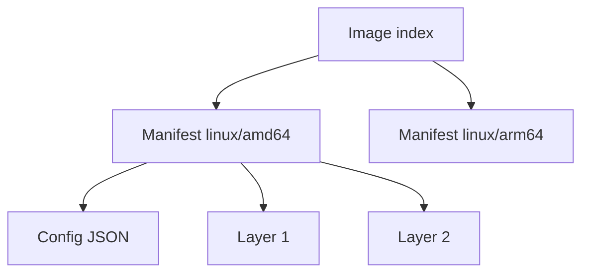

# Open Standards And The OCI Specifications

If every tool used a private format, moving from one container tool to another would mean rebuilding every image and rewriting every script. Open standards prevent this. This part explains what a standard is in the cloud native ecosystem and then covers the first and most important group of them: the Open Container Initiative (OCI) specifications, which define what a container image is and how a container runs.

## What an open standard gives you

An **open standard** is a published specification that anyone can implement, maintained by a vendor-neutral group. A product that follows it works with every other product that follows it. For a cloud native team this gives three benefits:

- **Portability.** An image built with one tool runs on any compliant runtime, on any cloud.
- **Choice.** A team can replace one component, for example the container runtime, without changing the others.
- **Competition and longevity.** Several implementations exist, so a project that stops does not strand its users.

A standard differs from an implementation. A **specification** says how the interface behaves. An **implementation** is software that follows it. A **managed service** is an implementation that a provider runs for you. The exam often asks you to tell these three apart: OCI is a specification, runc is an implementation, and a cloud container service is a managed service.

## The Open Container Initiative

The Open Container Initiative (OCI) is a Linux Foundation project created in 2015, when Docker donated its image format and runtime code, to keep containers vendor neutral. It maintains three specifications:

| Specification | What it defines |
| --- | --- |
| Image specification | The format of a container image |
| Runtime specification | How to run a container from a filesystem bundle |
| Distribution specification | The HTTP API to push and pull images in a registry |

## The image specification

An OCI image is a set of files that a registry stores and a runtime unpacks. It has these parts:

- **Layers.** Each layer is a compressed archive of filesystem changes. Layers are stacked, and layers that two images share are stored and downloaded once.
- **Config.** A JSON document with the environment variables, the default command, the working directory, the exposed ports and the layer list.
- **Manifest.** A JSON document that lists the config and the layers, each by its digest.
- **Index.** An optional JSON document that points to several manifests, one for each platform, such as `linux/amd64` and `linux/arm64`. The runtime chooses the one that matches the node.

Everything is **content addressed**. A **digest** such as `sha256:...` is the SHA-256 hash of the content. If the content changes by one byte, the digest changes. A **tag** such as `6.15.0` is a human-friendly name that a registry maps to a digest, and a maintainer can move a tag to a different digest later. For that reason, a reference by digest is the only one that always means the same bytes.



The diagram shows that an index points to one manifest per platform, and a manifest points to one config and to the layers.

## The runtime specification

The runtime specification describes a **filesystem bundle**: a directory with a `rootfs` folder, which holds the files of the container, and a `config.json` file. The file lists the process to start, the user, the mounts, the Linux namespaces, the control groups (cgroups) for CPU and memory limits and the capabilities. A runtime that follows the specification reads the bundle and starts the process with those isolation settings.

The reference implementation is **runc**, a low-level runtime written in Go that creates the namespaces and cgroups and starts the process. Other OCI runtimes exist: **crun** is written in C and starts faster, and **gVisor** (`runsc`) and **Kata Containers** add stronger isolation by running the container behind a user-space kernel or inside a lightweight virtual machine. Because they follow the same specification, a higher-level tool can swap one for another.

## The distribution specification

The distribution specification defines the HTTP API of a registry: how to push and pull manifests and layers by digest, and how to list tags. This is why `docker`, `podman`, `crane`, `skopeo` and a Kubernetes node can all pull from the same registry, whether it is Docker Hub, GitHub Container Registry, Harbor or a registry of a cloud provider. Harbor is a CNCF graduated registry project.

## See the image reference in the cluster

<!-- astrona:playground:renew -->

A pod spec holds an image reference. Read the reference of `scout`, then read the digest that the container runtime resolved:

```sh
kubectl -n starfleet get deployment scout -o jsonpath='{.spec.template.spec.containers[0].image}{"\n"}'
kubectl -n starfleet get pod -l app=scout -o jsonpath='{.items[0].status.containerStatuses[0].imageID}{"\n"}'
```

The first command prints the tag that the manifest uses. The second prints the `imageID`, which holds the digest of the image that the node actually pulled. If the tag is moved in the registry, a new node can pull different content under the same tag, while the `imageID` shows what this pod runs.

## Summing up and what is still open

The OCI specifications define the image format, the way to run a container and the registry API. A tag is a name and a digest is the content. runc, crun, gVisor and Kata are implementations of the runtime specification. The OCI says nothing about Kubernetes, so the question remains how the kubelet talks to a runtime. That is the job of the Container Runtime Interface.

## Common pitfalls

> [!WARNING]
> - **Confusing OCI with Docker.** Docker is a product. OCI is the set of specifications that Docker's format became.
> - **Trusting a tag as fixed content.** A tag can move. Use the digest when you need the exact image.
> - **Mixing up specification and implementation.** The OCI runtime specification is not runc, and runc is not a container manager.
> - **Pulling an image built for another platform.** An `arm64` image does not run on an `amd64` node unless the index offers both.
