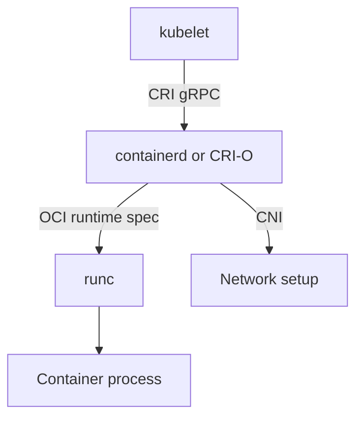

# The Container Runtime Interface And Runtime Classes

The kubelet is the agent on each node that starts the pods. It does not know how to unpack an image or to create a Linux namespace. It asks a container runtime to do it. In the early years Kubernetes had Docker hard-coded into the kubelet, which made every other runtime a special case. The Container Runtime Interface (CRI) replaced that code with one interface. This part explains the CRI, the layers below it and the Kubernetes object that selects a runtime for a pod.

## What the CRI is

The **Container Runtime Interface (CRI)** is a gRPC API between the kubelet and a container runtime. The API has two services:

- **RuntimeService** manages pod sandboxes and containers: create, start, stop, remove, list and execute a command.
- **ImageService** pulls, lists and removes images.

Any runtime that implements these services can be used by the kubelet. The two common ones are **containerd** (a CNCF graduated project, the default of most clusters and of kind) and **CRI-O** (a CNCF incubating project, built only for Kubernetes). Since Kubernetes 1.24 the kubelet no longer contains the built-in Docker support called dockershim. Images built with Docker still run, because they follow the OCI image specification.

## The layers on a node



The diagram shows the chain. The kubelet sends CRI calls. The high-level runtime, containerd or CRI-O, pulls the image, prepares the bundle and sets up networking through the CNI. It then calls a low-level OCI runtime, usually runc, which creates the process. When the process runs, runc exits, and a small shim process stays to watch the container.

The distinction matters in practice. A **high-level runtime** manages images, storage and the lifecycle of containers and sandboxes, and speaks CRI. A **low-level runtime** only starts a container from an OCI bundle.

## The pod sandbox

CRI works with a **pod sandbox**: the shared environment of a pod, which holds the network namespace and other shared Linux namespaces. The runtime creates the sandbox first, calls the CNI plugin to give it a network, and then starts the containers inside it. This is why all containers of a pod share one IP address.

## Debugging with crictl

`crictl` is a command-line client for the CRI. It talks to the runtime socket on a node, so it runs on the node and not through the API server. It is useful when the API server is not available or when you need to see what the runtime sees: `crictl ps` lists containers, `crictl pods` lists sandboxes, `crictl images` lists images and `crictl logs` prints container logs. The normal tool for an application is `kubectl`.

## Runtime classes

A cluster can have more than one OCI runtime on a node. A **RuntimeClass** is a Kubernetes object that names a runtime configuration. Its field `handler` is the name of the runtime configuration in the CRI implementation, for example `runc`, `runsc` for gVisor, or a Kata handler. A pod selects it with `spec.runtimeClassName`. A team could run its ordinary workloads with `runc` and untrusted code with gVisor.

RuntimeClass is a cluster-scoped object. It can also carry `overhead`, the CPU and memory that the runtime itself needs, which the scheduler adds to the pod's requests, and `scheduling`, a node selector and tolerations that place the pod only on nodes that have the runtime.

Save this as `runtimeclass-standard.yaml`. The kind node uses containerd with the `runc` handler, so this class works in the playground:

<!-- astrona:playground:renew -->

```yaml
apiVersion: node.k8s.io/v1
kind: RuntimeClass
metadata:
  name: standard-runc
handler: runc
```

Apply it:

```sh
kubectl apply -f runtimeclass-standard.yaml
```

Then save this pod as `pod-runtime-test.yaml`:

```yaml
apiVersion: v1
kind: Pod
metadata:
  name: runtime-test
  namespace: starfleet
spec:
  runtimeClassName: standard-runc
  containers:
    - name: runtime-test
      image: curlimages/curl:8.22.0
      command: ["sh", "-c", "sleep 3600"]
```

Apply it and read the field back:

```sh
kubectl apply -f pod-runtime-test.yaml
kubectl -n starfleet get pod runtime-test -o jsonpath='{.spec.runtimeClassName}{"\n"}'
```

If the name of a RuntimeClass does not exist, or the handler is not configured on the node, the pod stays unstarted and `kubectl describe pod` shows an event about the runtime. Delete the test pod when you finish:

```sh
kubectl -n starfleet delete pod runtime-test
```

## Summing up and what is still open

The CRI is the gRPC interface between the kubelet and a high-level runtime such as containerd or CRI-O, which in turn calls an OCI runtime such as runc. A RuntimeClass lets a pod choose among the configured runtime handlers. The runtime also needs a network for the sandbox and storage for the volumes, and Kubernetes defines separate interfaces for both.

## Common pitfalls

> [!WARNING]
> - **Saying Kubernetes dropped Docker images.** Kubernetes removed dockershim, the built-in Docker runtime support. Docker-built images are OCI images and still run.
> - **Mixing up containerd and runc.** containerd manages images and containers and calls runc, which creates the process.
> - **Using `crictl` as a replacement for `kubectl`.** It shows runtime objects on one node and knows nothing about Deployments.
> - **A RuntimeClass whose handler the node does not have.** The pod cannot start.
