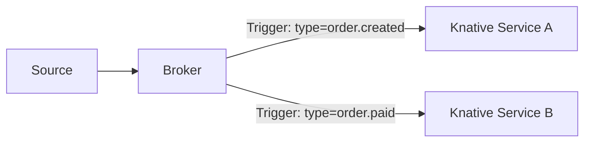

# Knative Serving And Eventing

Knative is a CNCF project that adds serverless features to Kubernetes. It has two parts that work separately: **Serving** runs request-driven workloads and scales them, and **Eventing** routes events between producers and consumers. Knative graduated in the CNCF in 2025.

## Knative Serving

Serving defines custom resources on top of Kubernetes.

- **Service** (the Knative `Service`, not the Kubernetes `Service`) describes a workload by its container image. Knative creates and manages everything below it.
- **Revision** is an immutable snapshot of the code and configuration. Each change to the Service creates a new revision.
- **Route** maps a network endpoint to one or more revisions, with a percentage of traffic for each.
- **Configuration** holds the desired state of the latest revision.

Because a route can split traffic between revisions, Serving supports canary releases and rollbacks without extra tools: send 10 percent of requests to the new revision, watch the result and raise the share or go back.

## Autoscaling and scale to zero

Serving puts a component called the **activator** in the request path when a workload has no running pod. The activator receives the request, asks the autoscaler to start a pod, holds the request until the pod is ready and forwards it. A sidecar proxy in each pod, the queue-proxy, measures concurrency, and the Knative Pod Autoscaler (KPA) uses this to add or remove pods. When no request arrives for a configured period, the count falls to zero. The Kubernetes Horizontal Pod Autoscaler can also be used, but it cannot scale to zero.

A Knative Service is short. This example is shown for reading and is not applied in the playground, because Knative is not installed there:

```yaml
apiVersion: serving.knative.dev/v1
kind: Service
metadata:
  name: hello
spec:
  template:
    spec:
      containers:
        - image: ghcr.io/stefanprodan/podinfo:6.15.0
```

The single resource replaces the Deployment, the Service, the Ingress and the autoscaler that a team would write by hand.

## Knative Eventing

Eventing connects event producers to consumers without a direct link between them. Events follow the CloudEvents format.

- **Source** produces events from something outside or inside the cluster, such as an HTTP endpoint, a Kafka topic or a Kubernetes API event.
- **Broker** receives events and stores them for delivery.
- **Trigger** is a subscription. It filters events from a broker by attribute, for example by type, and delivers matching events to a subscriber.
- **Channel and Subscription** are a lower-level way to fan out events to several consumers.

A consumer can be a Knative Service, so an event can start a workload that scales from zero, handles the event and returns to zero.



## Other function platforms on Kubernetes

Knative is not the only option. **OpenFaaS** and **Fission** run functions on Kubernetes with their own tools for building and deploying. **KEDA** does not run functions. It adds event-driven scaling to normal workloads, which the next part covers.

## Check what is installed

The playground has no Knative. You can list the custom resources that a cluster knows with:

<!-- astrona:playground:renew -->

```sh
kubectl api-resources | grep -i knative
```

The command prints nothing here, because the Knative custom resource definitions are not installed. On a cluster with Knative, the list contains `services.serving.knative.dev`, `revisions`, `routes`, `brokers` and `triggers`.

## Common pitfalls

> [!WARNING]
> - **Confusing the two Services.** A Kubernetes `Service` exposes pods. A Knative `Service` describes a whole workload.
> - **Expecting scale to zero from the Horizontal Pod Autoscaler.** It does not scale below one replica by default.
> - **Mixing Serving and Eventing.** Serving handles requests and scaling. Eventing handles event routing. A cluster can run either one alone.
> - **Sending a request to a scaled-to-zero workload and expecting no delay.** The first request waits for a cold start.
