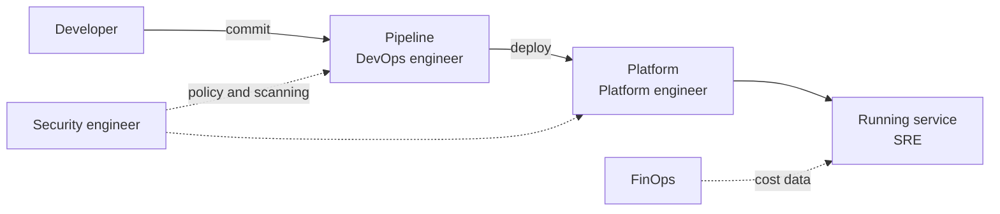

# The Main Cloud Native Roles

Role names differ between companies, and one person can hold several. The exam uses the common names. This part lists them with what each one owns and what each one needs from the others.

## The roles

| Role | Main responsibility | Typical tools |
| --- | --- | --- |
| Developer | Writes application code and its tests, and often owns the service in production | Git, CI pipelines, container images |
| DevOps engineer | Connects development and operations through automation of build, test and release | CI/CD, infrastructure as code |
| Platform engineer | Builds and runs the shared platform that developers use | Kubernetes, GitOps, service catalogs |
| Site reliability engineer (SRE) | Keeps services reliable using software and measurable targets | Monitoring, alerting, incident response |
| Cloud architect | Designs the overall system and chooses services and patterns | Reference architectures, cost and risk analysis |
| Security engineer (DevSecOps) | Builds security into the pipeline and the platform | Scanners, policy engines, secrets management |
| Cluster administrator | Operates the Kubernetes clusters | kubectl, upgrades, backup |
| FinOps practitioner | Manages and optimizes cloud cost with engineering and finance | Cost reports, budgets, tagging |
| Data and ML engineer | Runs data pipelines and model workloads on the platform | Batch jobs, GPUs, storage |

## Where the roles meet



A developer commits code. A pipeline, built by the DevOps or platform team, tests and packages it. The platform runs it. The SRE watches the service level and responds to incidents. Security and cost work apply to every step.

## Responsibility models

Two models are common.

- **You build it, you run it.** The team that writes a service also operates it. This gives the developer a direct view of the effects of the code and shortens the feedback loop.
- **Separate operations.** A dedicated operations team runs the software that developers hand over. This often creates a wall between the groups and slows releases, which is the problem DevOps was created to solve.

## Roles on the exam

The exam describes a situation and asks which role fits. For example, a person who defines the target that 99.9 percent of requests must succeed and tracks the error budget is an SRE. A person who builds a self-service tool for teams to create namespaces is a platform engineer. A person who adds a vulnerability scan to the pipeline is acting as a security engineer, even if the job title is developer.

## Look at who acts in a cluster

In a cluster, a role appears as a set of permissions. Ask the cluster who you are and what you may do:

<!-- astrona:playground:renew -->

```sh
kubectl auth whoami
kubectl auth can-i --list --namespace starfleet
```

As the cluster administrator you may do everything. The next parts show how to give a persona only what its role needs.

## Common pitfalls

> [!WARNING]
> - **Treating titles as fixed.** One person can hold several roles, and one role has different titles.
> - **Mixing up DevOps and SRE.** DevOps is a culture and a set of practices. SRE is a specific engineering discipline with targets and error budgets.
> - **Making the platform team a ticket queue.** A platform is a product with self-service, not a request desk.
> - **Leaving security to the end.** It belongs in every step of the pipeline.
