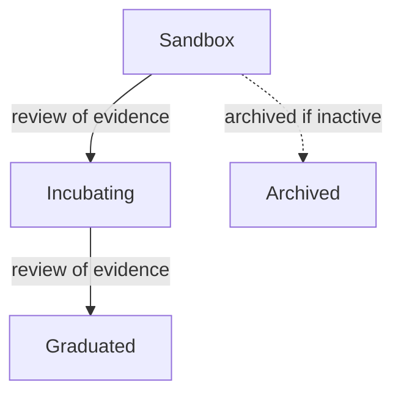

# Governance, Maturity And Licenses

A team plans to depend on a cloud native project and to contribute a fix. Before it writes any code, it needs answers to three questions. Who decides what the project does? Under which conditions may the team use and change it? How does a change get accepted? This part answers those questions and ends by recording the evidence for a dependency decision in the cluster.

## Governance

**Governance** describes how a project makes decisions, appoints maintainers and handles proposals. A **maintainer** is a person with the right to review and merge changes. Governance documents usually say how a person becomes a maintainer, how disagreements are resolved, how often releases happen and which decisions need wider discussion. A project without a clear decision process can be hard to work with even when its download count is high.

A foundation adds a second layer. The **Cloud Native Computing Foundation** (CNCF) is a vendor-neutral foundation that hosts projects such as Kubernetes, Prometheus and Envoy. It provides legal ownership of trademarks, shared infrastructure, events and a review process. It does not write the project's code, and it does not decide the daily technical questions. Those stay with the project's maintainers and their documented process.

## Maturity levels

The CNCF groups its projects into three maturity levels:

| Level | What it indicates |
| --- | --- |
| Sandbox | An early project that the foundation accepts for exploration and for building a community |
| Incubating | A project with growing adoption, more than one maintaining organization and documented governance, reviewed against stronger criteria |
| Graduated | A project with broad adoption, a healthy set of maintainers and a sustainable process, reviewed against the strictest criteria |

A project moves up through a review of evidence by the foundation's technical committee. The levels describe the project's development and the evidence assessed. They have limits that the exam expects you to know:

- A level is not a performance ranking. A Graduated project can be a poor fit for a narrow requirement.
- A level is not a security guarantee. Every project, at every level, can have vulnerabilities.
- A level is a snapshot. Status can change, so check the current status when a real choice depends on it.
- A level describes the project overall. A single feature of a Graduated project can still be experimental.



The diagram shows the normal path of a project through the levels and that a project which becomes inactive can be archived.

## Licenses

An **open source license** is a legal text that grants permissions to use, change and share software, and attaches conditions to those permissions. Two broad families exist:

- **Permissive** licenses, such as Apache License 2.0, MIT and BSD, allow use, modification and redistribution with few conditions, mostly keeping the copyright and license notices. Most CNCF projects use Apache License 2.0.
- **Copyleft** licenses, such as the GNU General Public License, add a condition: when you distribute a modified version, you must distribute its source under the same license.

Open source does not mean that code can be copied without obligations. Internal use and distribution of modified software can have different obligations, so identify the actual license and the intended use. Public source code without a license does not give permission to reuse it at all.

## Contribution rules

A license answers what you may do with the software. A **contribution process** answers what a project needs before it accepts your change. These are separate questions. A project may require:

- A **Developer Certificate of Origin** (DCO) sign-off. The contributor adds a line `Signed-off-by: Name <email>` to each commit, usually with `git commit -s`, certifying that they have the right to submit the change.
- A contributor license agreement, where the contributor signs a legal document once.
- Tests that cover the change, a style guide and agreement to a code of conduct.

Meeting a license's conditions does not make a change acceptable, and a DCO sign-off does not replace review. The maintainers decide whether a change fits the project's scope.

## Recording the evidence for a dependency

A dependency decision combines facts from all of the areas above. Record them where the team can find them, for example next to the deployment. A ConfigMap is a simple way to keep structured facts in the cluster.

<!-- astrona:playground:renew -->

Save this as `dependency-record.yaml`:

```yaml
apiVersion: v1
kind: ConfigMap
metadata:
  name: dependency-record-podinfo
  namespace: starfleet
data:
  project: podinfo
  license: Apache-2.0
  license-family: permissive
  contribution-rules: DCO sign-off, tests
  maturity-source: checked on the CNCF project page
  decision: adopt
  review-date: "2026-11"
```

Apply it:

```sh
kubectl apply -f dependency-record.yaml
```

Then check the result:

```sh
kubectl -n starfleet get configmap dependency-record-podinfo -o jsonpath='{.data}'
```

The command prints the keys and values. The record separates the license, the contribution rules and the source of the maturity information, so a later reader can see which question each fact answers and when it was last checked. Treat the values as an example: a real record comes from reading the project's own license file and contribution guide.

## Summing up and what is still open

Governance decides who decides, a maturity level shows how far the foundation's review has gone, a license sets the conditions of use, and a contribution process sets the conditions of acceptance. A sound dependency decision keeps these separate and records its evidence. What remains is the day-to-day path of a change through a project.

## Common pitfalls

> [!WARNING]
> - **Reading a maturity level as a quality grade.** It describes development and evidence, not fit or security.
> - **Treating public source as permission.** The license decides what you may do.
> - **Assuming a license also covers contribution rules.** A DCO sign-off, tests and review are separate requirements.
> - **Memorizing a permanent status.** Levels change, so check the current status.
> - **Assuming every CNCF project works the same way.** Each project has its own governance and contribution guide.
