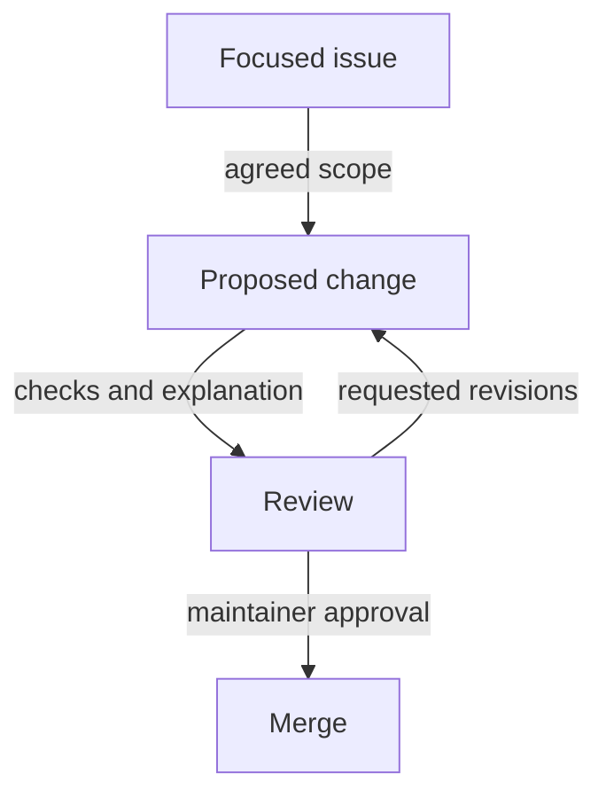

# Issues, Reviews And Working Groups

A learner notices that documentation confuses readiness with liveness. A focused issue can describe the incorrect statement, expected behavior and evidence. This is useful even when the reporter is not ready to change code. Reproducible observations and a clear scope help maintainers decide what needs correction.

A pull request proposes a versioned change for review. Keep it focused on the supported problem and explain the resulting behavior. Include checks appropriate to the change, such as validating an example or confirming a documentation statement. Reviewers need enough context to assess the proposal without reconstructing the author's whole investigation.

Review is collaborative work. Respond to questions with evidence, revise the change and keep the description aligned with the final result. Maintainers may reject a technically valid approach because it conflicts with the project's scope or compatibility promises. The published process determines who can approve and merge.

A Special Interest Group (SIG) organizes work around an area such as networking, storage or documentation in the Kubernetes community. Working groups often focus on a bounded effort involving several areas. Find the group's scope, communication channels and meeting notes before proposing broad changes.

A contribution moves from a clear problem through evidence and review to the project's acceptance decision.

Documentation, examples, reproduction reports and translations are useful contributions alongside code. Choose the community that owns the affected behavior and use its norms. Clear technical questions and respectful review responses make collaboration more effective than sending the same proposal indiscriminately to unrelated groups.

## A Reviewable Documentation Contribution

For an incorrect readiness statement, the issue should identify the page and sentence, state the correct behavior and explain the evidence. A focused correction can then update that statement and any nearby example whose meaning depends on it. This is easier to assess than rewriting unrelated material in the same proposal.

The pull request description should explain the final behavior for a reviewer who has not read the issue discussion. Appropriate validation can include checking the referenced configuration and confirming the terminology against primary documentation. A documentation change does not automatically need a large new test suite, but its technical claims still need evidence.

Review comments can expose a missing edge case or a mismatch with the project's writing style. Respond by clarifying the evidence and revising the proposal where needed. Keep the description synchronized with the actual result so approval applies to the change reviewers can inspect.

## Finding The Right Community Scope

A SIG has an ongoing area of responsibility, while a working group can coordinate a bounded cross-cutting effort. Their published charters, meeting notes and contribution channels show where a proposal belongs. A networking design affecting storage topology may need cooperation between areas instead of being submitted randomly to one repository.

Participation does not require a large feature. A clear reproduction, improved example, translation or focused review can remove real barriers for users. These contributions benefit from the same scope, evidence and respectful collaboration as code changes.

A completed contribution follows the project's acceptance process. Opening a request begins review; it does not grant merge rights or promise acceptance. The result can be a merged correction, a requested redesign or a documented decision not to proceed. Useful collaboration explains the problem clearly and works within the ownership contract.

## Common pitfalls

> [!WARNING]
> Opening a pull request does not bypass maintainer review. Choose a group from its actual scope, and follow the project's contribution and conduct requirements.
