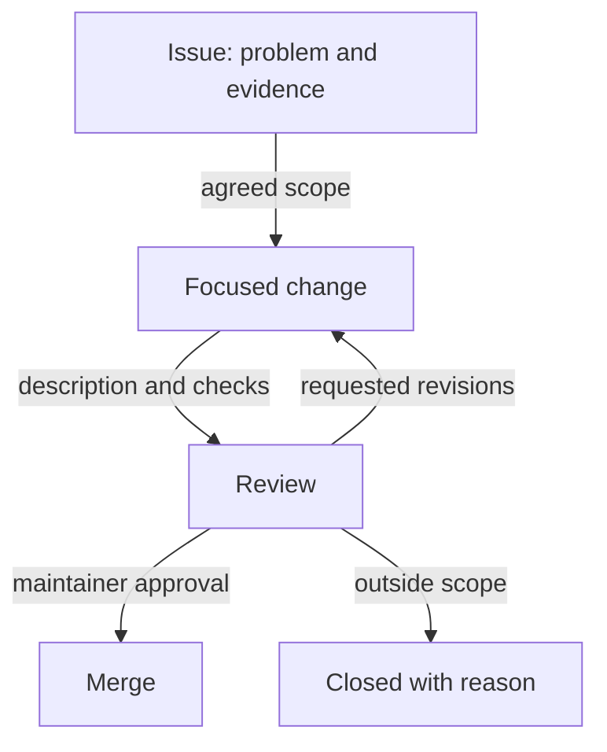

# Issues, Reviews And Working Groups

A learner notices that a deployment checks readiness on the same path as liveness. The mistake is small, but nobody will fix it until someone describes it clearly, proposes a change and works through review. This part follows one change from the first report to the decision, shows how to review a Kubernetes change before it is applied, and explains how to find the group that owns the area.

## The issue

An **issue** is a written report of a problem or a request. A useful issue is focused and gives the reader what they need without a conversation: which component, what happens now, what should happen instead and the evidence. For the readiness mistake, the report names the Deployment and the container, states that the readiness probe calls `/healthz` while the application serves `/readyz` for readiness, and shows the command that proves it.

Issues are valuable even when the reporter does not change any code. A reproducible observation lets maintainers decide whether the behavior is a defect, a documentation gap or a request they will not accept.

## The change and the pull request

A **pull request** (PR) proposes a versioned change for review. The change should solve the problem in the issue and nothing else. A small, focused change is easier to review, easier to test and easier to revert. The description explains the resulting behavior to a reviewer who has not read the discussion, and states how the change was checked.

On a cluster the same discipline applies to every object change. Before you apply a change, look at the difference between the live object and the proposed one. `kubectl diff` sends the manifest to the API server, which computes what would change, and prints a diff without storing anything.



The diagram shows that review can send a change back for revision and that it can also end in a decision not to proceed.

## Review

**Review** is collaborative work. A reviewer checks that the change solves the stated problem, fits the project's scope and compatibility promises, and is covered by checks. Respond to questions with evidence, revise the change and keep the description consistent with the final result. A reviewer can reject a technically correct change that does not fit the project. The published process says who can approve and who can merge. Opening a PR starts a review. It does not grant merge rights and it does not promise acceptance.

## Reviewing a change on a cluster

In the playground, `scout` has a readiness probe that calls `/healthz`. Look at it first.

<!-- astrona:playground:renew -->

```sh
kubectl -n starfleet get deployment scout -o jsonpath='{.spec.template.spec.containers[0].readinessProbe.httpGet.path}{"\n"}'
```

The command prints `/healthz`. Now write the proposed change as a patch to the whole object. Save this as `scout-fixed.yaml`:

```yaml
apiVersion: apps/v1
kind: Deployment
metadata:
  name: scout
  namespace: starfleet
  labels:
    app: scout
spec:
  replicas: 1
  selector:
    matchLabels:
      app: scout
  template:
    metadata:
      labels:
        app: scout
    spec:
      containers:
        - name: scout
          image: ghcr.io/stefanprodan/podinfo:6.15.0
          ports:
            - name: http
              containerPort: 9898
          readinessProbe:
            httpGet:
              path: /readyz
              port: http
          livenessProbe:
            httpGet:
              path: /healthz
              port: http
```

Review the difference without applying it:

```sh
kubectl diff -f scout-fixed.yaml
```

The diff shows the readiness path changing from `/healthz` to `/readyz`. The exit code of `kubectl diff` is 1 when differences exist and 0 when there are none, so scripts can use it as a check. The diff also lists any other lines that differ, such as defaults that the live object has and the file leaves out. A reviewer reads every changed line, not only the one the author meant to change.

When the diff shows only the intended change, apply it and record why:

```sh
kubectl apply -f scout-fixed.yaml
kubectl -n starfleet annotate deployment scout kubernetes.io/change-cause="readiness probe uses /readyz" --overwrite
kubectl -n starfleet rollout status deployment/scout
```

The annotation `kubernetes.io/change-cause` is the cluster equivalent of a PR description: it records the reason next to the object, and `kubectl rollout history` shows it.

## Finding the right group

Kubernetes organizes its community into groups with published scopes:

| Group | Scope | Example |
| --- | --- | --- |
| Special Interest Group (SIG) | An ongoing area of responsibility | SIG Network, SIG Storage, SIG Docs |
| Working group (WG) | A bounded effort that crosses several areas | A group that coordinates a cross-cutting feature |
| Subproject | A part of a SIG with its own repository | A component owned by one SIG |

Each group publishes a charter, meeting notes, a mailing list and a chat channel. Before a proposal that affects several areas, read the charters to find which group owns the behavior. A design that touches both networking and storage needs discussion with both areas, and sending the same proposal to unrelated groups does not help.

Participation does not need a large feature. Reproduction reports, better examples, translations and careful review of other people's changes remove real barriers for users, and they follow the same rules of scope, evidence and respect as code.

## Summing up and what is still open

A contribution moves from a focused issue to a small change, through review, to a decision that can be a merge, a revision request or a rejection. On a cluster, `kubectl diff` is the review step before an apply, and the change-cause annotation records the reason. What remains is to practice the whole cycle on a broken workload.

## Common pitfalls

> [!WARNING]
> - **Applying without a diff.** A manifest can change more than its author intended.
> - **A change that mixes several fixes.** Reviewers cannot approve one part without the others.
> - **Treating an opened PR as accepted.** Review and the maintainers' decision come after it.
> - **Sending a proposal to the wrong group.** Read the charter and scope first.
> - **Forgetting the reason.** A change without a recorded cause is hard to audit later.
