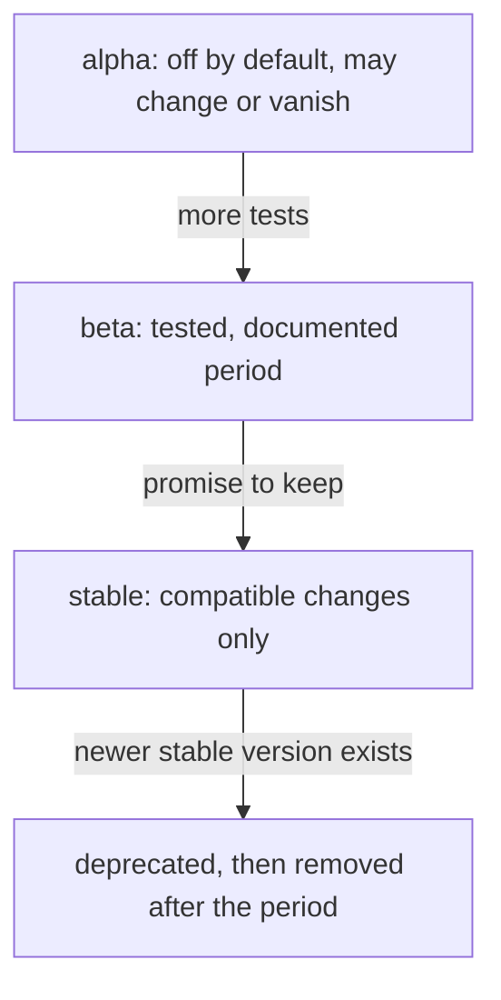

# API Maturity Levels And Feature Gates

A team copies a manifest from a blog post. It starts with `apiVersion: batch/v1beta1`, and it works on an old cluster and fails on a new one. The version in the first line carried a signal that the team did not read. This part explains how to read that signal: what the three maturity levels promise, how the version string is built and how a feature gate controls whether a feature exists at all.

## How an apiVersion is built

An `apiVersion` has two parts separated by a slash: the **API group** and the **version**. The group `apps` and the version `v1` give `apps/v1`. The core group has an empty name, so it appears as just `v1`, as in a Pod or a Service. A kind, such as Deployment, belongs to one group, and the same kind can be served in more than one version at a time.

The version string tells the maturity:

| Pattern | Level | Example |
| --- | --- | --- |
| `v1alpha1`, `v1alpha2` | Alpha | `fleet.example.com/v1alpha1` (a made-up group) |
| `v1beta1`, `v2beta2` | Beta | `autoscaling/v2beta2` (removed) |
| `v1`, `v2` | Stable, also called general availability | `apps/v1`, `batch/v1` |

The number after `v` is the major version of the API. The suffix `alpha` or `beta` and its own number show a pre-release iteration of that major version.

## What each level promises

**Alpha** is for early feedback. The feature is disabled by default, it can contain bugs, it can change in incompatible ways without notice, and it can be removed in any release. Do not build production workloads on alpha.

**Beta** is for wider testing. The code is well tested and the project intends to keep the feature, but details of the schema can still change. Beta features are usually enabled by default. Newer policy goes further: new beta REST APIs are off by default unless the project decides otherwise, so you may need to enable the version explicitly. Beta versions follow a documented deprecation period.

**Stable** versions are committed to. A feature at general availability has tests, documentation and a promise: the project does not make an incompatible change within the same version, and a version is removed only after a replacement exists and a long deprecation period has passed.



The diagram shows the usual path of a feature. A stable version is also deprecated one day, but only after a replacement exists.

## Feature gates

A **feature gate** is a named switch for a feature of the Kubernetes components. A gate has a stage and a default:

| Stage | Default | Meaning |
| --- | --- | --- |
| Alpha | Off | Opt-in, no promise |
| Beta | On, with exceptions | Tested, can still change |
| GA | On, and locked | The gate is no longer needed and is removed later |
| Deprecated | Depends | The feature is on its way out |

An operator sets gates with a flag on the component, `--feature-gates=Name=true`. Gates are per component, so a gate on the API server does not enable the matching behavior in the kubelet. Gates connect to API versions: an alpha API version is usually served only when its gate and the matching runtime configuration are enabled.

## Looking at the playground cluster

List the API versions that the API server serves, and find the version of one kind.

<!-- astrona:playground:renew -->

```sh
kubectl api-versions
kubectl api-resources --api-group=autoscaling
```

The first command prints every group and version in the form `group/version`. Groups such as `apps/v1` and `batch/v1` appear, and so do beta or alpha versions that the cluster serves, if any are enabled. The second command lists the kinds of one group with the version that the command picked as preferred. Notice that a group can appear with several versions, for example `autoscaling/v1` and `autoscaling/v2`.

Now ask the API server how it describes a field, including the version:

```sh
kubectl explain horizontalpodautoscaler --api-version=autoscaling/v2
kubectl explain horizontalpodautoscaler.spec.metrics --api-version=autoscaling/v2
```

The output shows the documented schema for that version of the API, taken from the cluster itself. The documentation comes from the same source as the validation, so it is always correct for the cluster you are connected to.

## Custom resources follow the same convention

A CustomResourceDefinition lists its versions with the same naming. A project that publishes `v1alpha1` for its kind says that the schema can still change. When you pick a project from the ecosystem, read the versions of its custom resources as part of the choice. A project whose objects are `v1beta1` can be mature as a product and still allow API changes, while a project that ships `v1` has made a compatibility promise for that kind.

## Summing up and what is still open

An apiVersion carries a group, a version and a maturity level. Alpha has no promise, beta has a documented deprecation period, and stable is committed to. Feature gates switch features on and off per component and move with the stage of the feature. What remains is the schedule on which versions are deprecated and removed, and how to find deprecated use in a cluster.

## Common pitfalls

> [!WARNING]
> - **Copying a manifest without reading its apiVersion.** The version can be removed in the cluster you use.
> - **Using alpha in production.** There is no promise of compatibility or availability.
> - **Assuming beta is always enabled.** Newer beta APIs can be off by default.
> - **Treating a feature gate as an API version.** A gate switches a feature on a component, and a version names an API.
> - **Reading `v2beta2` as newer than `v1`.** The suffix shows the maturity, not the order of the stable versions.
