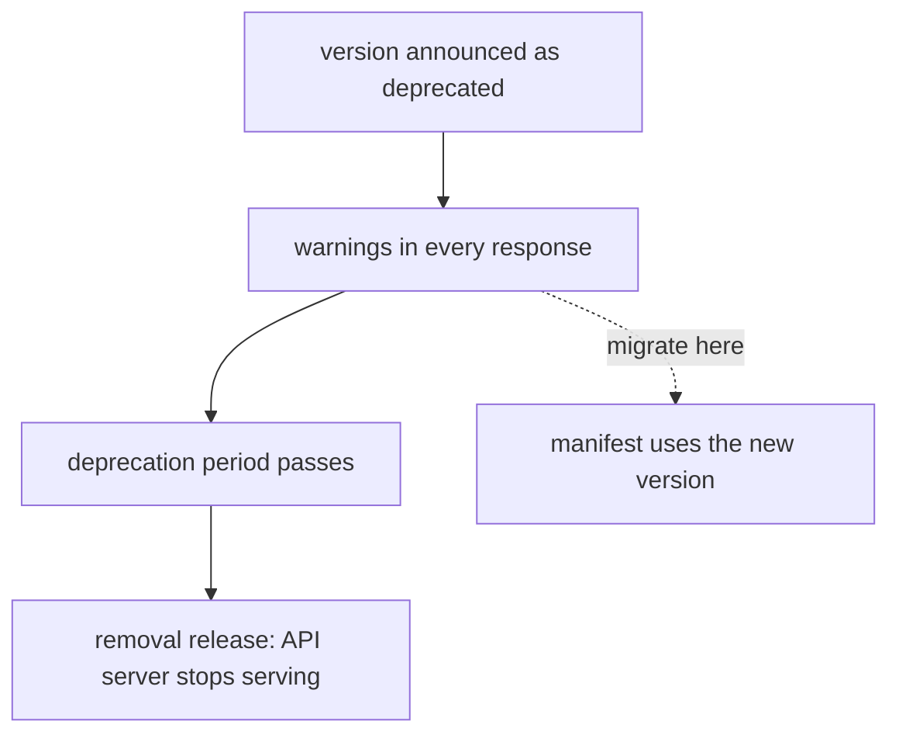

# The Deprecation Policy And Finding Deprecated Use

A cluster upgrade is scheduled for Friday. On Thursday, a pipeline that applies a manifest fails with a message that no kind exists in that version. The version was deprecated for more than a year, and the warnings were printed on every apply, but nobody read them. This part explains the rules that make the schedule predictable and shows how to find deprecated use before an upgrade.

## Deprecated and removed

**Deprecation** is a notice that an API version will be removed. The version still works, and clients are told to move. **Removal** is the later step in which the API server stops serving the version. Objects already stored are not lost: the API server converts and keeps them under a version that is still served. What breaks is every client that still sends the old version, such as a manifest, a Helm chart, a controller or a script.

## The policy

Kubernetes publishes a deprecation policy. The rules for REST APIs are:

| Level | Minimum time after deprecation is announced |
| --- | --- |
| Stable (GA) | 12 months or 3 releases, whichever is longer |
| Beta | 9 months or 3 releases, whichever is longer |
| Alpha | 0, so it can be removed in any release |

Further rules limit the possibility of a surprise:

- A stable version can be deprecated only when a newer stable version of the same API exists.
- A feature cannot move from stable back to beta or alpha under the same name.
- Every deprecation is announced in the release notes and recorded in a deprecation guide that lists the old version, the new version and the release of removal.
- Kubernetes releases about three times a year, so three releases are about a year.

A **removal release** is the first version without the old API. A cluster that skips from a version before the removal to one after it breaks every manifest that still uses the removed version. Upgrades are best done one minor version at a time, which also gives each warning its chance to be seen.

## Examples of removed versions

These removals happened a long time ago and are still the most common cause of broken manifests:

| Old version | Kind | Current version |
| --- | --- | --- |
| `extensions/v1beta1` and `networking.k8s.io/v1beta1` | Ingress | `networking.k8s.io/v1` |
| `batch/v1beta1` | CronJob | `batch/v1` |
| `policy/v1beta1` | PodDisruptionBudget | `policy/v1` |
| `autoscaling/v2beta1` and `autoscaling/v2beta2` | HorizontalPodAutoscaler | `autoscaling/v2` |



The diagram shows that the time between announcement and removal is the time to migrate, and that the warnings appear in every response during it.

## How the cluster warns

When a client calls a deprecated API, the API server adds a `Warning` header to the response, and `kubectl` prints it. Warnings are not errors, so a script can ignore them without noticing. The API server also counts every request to a deprecated API in the metric `apiserver_requested_deprecated_apis`, labeled with the group, version, resource and the release in which it will be removed. The metric answers a bigger question than a warning does: which clients in the whole cluster still use a deprecated version.

## Finding deprecated use

Look at what the cluster serves, then read the metric from the API server.

<!-- astrona:playground:renew -->

```sh
kubectl api-versions | sort
kubectl get --raw /metrics | grep apiserver_requested_deprecated_apis | head
```

The first command lists the served versions in sorted order. The second command prints one line for each deprecated API that someone has called since the API server started. On a fresh cluster the list can be empty, which means no deprecated version has been requested.

Now try a manifest that uses a removed version. Save this as `pdb-legacy.yaml`:

```yaml
apiVersion: policy/v1beta1
kind: PodDisruptionBudget
metadata:
  name: scout-pdb
  namespace: starfleet
spec:
  minAvailable: 1
  selector:
    matchLabels:
      app: scout
```

Apply it:

```sh
kubectl apply -f pdb-legacy.yaml
```

The command fails. The client reports that it found no match for the kind PodDisruptionBudget in version `policy/v1beta1`, because the API server does not serve that version at all. This failure is the removal made visible: the manifest text is the same as before, but the cluster no longer understands it.

Ask the cluster which version it does serve for the kind:

```sh
kubectl api-resources --api-group=policy
kubectl explain poddisruptionbudget --api-version=policy/v1 | head -n 12
```

The first command shows the kind in the group `policy`, and the second prints its documented schema in version `policy/v1`.

## Checking before an upgrade

Three habits remove surprises. First, read the deprecation guide for every release between the current cluster version and the target. Second, search the manifests, charts and templates for the versions that the guide lists. Third, check a running cluster with the deprecated-use metric, because clients that apply objects at runtime, such as controllers, do not appear in a source search. An upgrade is safe when neither the source nor the metric shows a version that the target release removes.

## Summing up and what is still open

The deprecation policy gives stable APIs at least a year and beta APIs about nine months, while alpha has no promise. The API server warns on each use of a deprecated version and counts the use in a metric, and removal makes the old manifest fail. What remains is the migration itself: changing the version and checking that the fields still mean the same thing.

## Common pitfalls

> [!WARNING]
> - **Ignoring warnings.** They are the only notice a script receives before removal.
> - **Searching only the manifests.** Controllers and tools can call old versions at runtime, and the metric shows them.
> - **Skipping minor versions in an upgrade.** A removal in a skipped release breaks manifests with no warning period left.
> - **Assuming stored objects are lost at removal.** The data stays, and only the old version name stops working.
> - **Treating a missing warning as proof of safety.** Check the guide for the target release as well.
