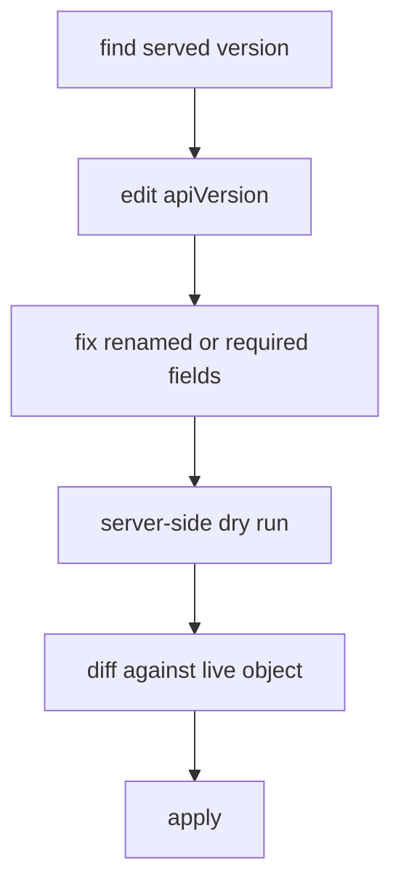

# Migrating Manifests To Current Versions

Changing `policy/v1beta1` to `policy/v1` looks like a one-word edit. For some kinds it is. For others the new version renames fields, changes a default or makes a field required, and a manifest that applies cleanly can still behave differently. This part gives a repeatable method for migrating a manifest and shows it on a PodDisruptionBudget.

## The method

A migration has five steps, and each one answers a different question:

1. **Find the target version.** Ask the cluster which version it serves for the kind, with `kubectl api-resources` and `kubectl explain --api-version`.
2. **Change the apiVersion.** Edit the first line of the manifest.
3. **Fix the schema.** Compare the fields with the output of `kubectl explain` and the project's deprecation guide, and fix renamed, moved or newly required fields.
4. **Check with the API server.** Run `kubectl apply --dry-run=server`, which sends the object through validation and admission without storing it.
5. **Review and apply.** Run `kubectl diff` against the live object, then apply.



The diagram shows that the cluster checks the manifest twice, with a dry run and a diff, before the real apply.

## What changes between versions

A version change can include four kinds of difference:

| Difference | Example |
| --- | --- |
| Renamed or moved field | In `autoscaling/v2beta1`, a CPU target was `targetAverageUtilization`. In `autoscaling/v2` it is `target.averageUtilization` with `target.type: Utilization` |
| Newly required field | In `networking.k8s.io/v1` Ingress, each path needs a `pathType`, and the backend uses `service.name` and `service.port` |
| Changed default or meaning | An empty selector in a PodDisruptionBudget matches no pods in `policy/v1beta1` and all pods in the namespace in `policy/v1` |
| Replaced mechanism | The Ingress class annotation was replaced by the field `ingressClassName` |

The last two rows are the dangerous ones. A manifest that is accepted can still behave differently, so the migration is not finished when the apply succeeds. For the HorizontalPodAutoscaler, the version `autoscaling/v2beta2` has the same schema as `autoscaling/v2`, and the migration changes only the first line. For older `v2beta1`, the metric fields must be rewritten.

## Tools

The `kubectl convert` command is a separate plugin, called `kubectl-convert`, that you download and install. It rewrites a manifest from an old version to a new version when the cluster still knows both. It cannot be a substitute for review, because it cannot know your intent. Linters and scanners that read manifests and charts can list removed versions across a repository, and they are the usual way to check a large code base.

## Migrating a PodDisruptionBudget

A PodDisruptionBudget limits how many pods of an application can be removed at once by voluntary actions, such as a node drain. Create one for `scout` in the current version.

<!-- astrona:playground:renew -->

Check the served version first:

```sh
kubectl api-resources --api-group=policy
kubectl explain poddisruptionbudget.spec --api-version=policy/v1
```

The output shows the kind in the group `policy` and lists the fields `minAvailable`, `maxUnavailable`, `selector` and `unhealthyPodEvictionPolicy`. Now save this as `pdb-scout.yaml`:

```yaml
apiVersion: policy/v1
kind: PodDisruptionBudget
metadata:
  name: scout-pdb
  namespace: starfleet
spec:
  minAvailable: 1
  selector:
    matchLabels:
      app: scout
```

Run the server-side dry run and the diff:

```sh
kubectl apply --dry-run=server -f pdb-scout.yaml
kubectl diff -f pdb-scout.yaml
```

The dry run reports that the object would be created and stores nothing. The diff shows the whole object as new lines, because no live object exists yet. Apply it:

```sh
kubectl apply -f pdb-scout.yaml
```

Then check the result:

```sh
kubectl -n starfleet get pdb scout-pdb
kubectl get --raw /apis/policy/v1/namespaces/starfleet/poddisruptionbudgets/scout-pdb
```

The first command shows the budget with `MIN AVAILABLE` equal to 1. The second command reads the object directly through the version `policy/v1`, which proves that the API server serves it there. With one replica of `scout` and `minAvailable: 1`, a drain of the node would be blocked, because the budget does not allow the only pod to go. The migration changed the version, and it did not change that behavior.

## Keeping manifests current

Keep a manifest current by treating the version as part of its maintenance. Check the manifests of long-lived applications before each cluster upgrade. Prefer stable versions for anything that must last. When a project's own custom resources are still beta, record the version and plan for the project's own migration guide, because the cluster does not convert for you.

## Summing up and what is still open

Migration follows a fixed order: find the served version, change the first line, fix fields that moved or became required, check with a server-side dry run, review the diff and apply. The risk is in changed defaults and meanings, not only in renamed fields, so a migration is proven by behavior and not by a successful apply. What remains is to apply the method to a set of broken manifests.

## Common pitfalls

> [!WARNING]
> - **Editing only the first line.** Renamed fields, required fields and changed defaults need a review.
> - **Trusting an accepted apply.** A new default can change behavior, such as a selector that now matches more pods.
> - **Skipping the dry run.** The server-side check finds schema errors before anything is stored.
> - **Forgetting `kubectl-convert` is a separate download.** It is not part of the normal `kubectl` binary.
> - **Migrating only manifests.** Charts, templates and controllers can still carry the old version.
