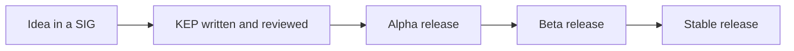

# Kubernetes Governance, SIGs And KEPs

Kubernetes is one of the largest open source projects, with thousands of contributors from many companies. Its governance spreads the work over groups, each with clear ownership, so that no single company controls the direction.

## The Steering Committee

The **Kubernetes Steering Committee** has seven elected members. It does not decide on technical matters. It sets the governance, handles the Code of Conduct process together with the Code of Conduct Committee, runs the elections and settles conflicts between groups. Members serve two-year terms, and the community votes each year for part of the seats.

## Special Interest Groups

A **Special Interest Group (SIG)** owns an area of the project. Examples:

| SIG | Area |
| --- | --- |
| SIG Architecture | The design principles and the API conventions |
| SIG API Machinery | The API server and the machinery that supports custom resources |
| SIG Apps | Workload APIs such as Deployments and Jobs |
| SIG Network | Services, DNS and network policy |
| SIG Node | The kubelet and the runtime interface |
| SIG Storage | Volumes and the storage interface |
| SIG Auth | Authentication, authorization and secrets |
| SIG Scheduling | The scheduler |
| SIG Release | The release process |
| SIG Docs | The documentation |
| SIG Testing | The test infrastructure |

Each SIG has chairs and technical leads, a charter, regular public meetings, a mailing list and a channel in the Kubernetes Slack. A SIG owns **subprojects**, for example the kubectl code belongs to SIG CLI.

## Working groups and user groups

A **working group (WG)** handles a topic that crosses several SIGs for a limited time, for example data protection or batch workloads. A WG does not own code. It coordinates and brings proposals to the SIGs that do. A **user group** is a community around a use case. A **committee** handles a governance matter, such as the Steering Committee and the Code of Conduct Committee.

## Who may approve a change

The repositories use **OWNERS files**. A file lists **reviewers**, who check the change, and **approvers**, who may merge it. A change needs the labels `lgtm` ("looks good to me", from a reviewer) and `approved` (from an approver) before the bot merges it. Changes also need to pass the automated tests. This process runs on the Prow system.

## Kubernetes Enhancement Proposals

A large change needs a design review before code. A **Kubernetes Enhancement Proposal (KEP)** is a document in the enhancements repository that states the motivation, goals, design, risks and test plan of a change. The owning SIG reviews it. A KEP tracks the **graduation** of a feature through stages:

- **Alpha.** Off by default, behind a feature gate. The feature may change or be removed.
- **Beta.** Often on by default, the feature is tested, and the API is not final.
- **Stable (GA).** On by default, with a compatibility promise.

The stages match the `v1alpha1`, `v1beta1` and `v1` API version names. A feature may stay in a stage for several releases and needs production readiness review before it moves on.

## How a feature travels



## Look at the feature gates of the cluster

The API server reports its feature gates in the metrics endpoint. Read a few of them from the cluster:

<!-- astrona:playground:renew -->

```sh
kubectl get --raw /metrics | grep -m 5 '^kubernetes_feature_enabled'
```

Each line names a feature and its stage and shows with a value of 1 or 0 whether it is on. Alpha features are off by default, which keeps new features away from clusters that do not ask for them.

## Common pitfalls

> [!WARNING]
> - **Thinking one company controls Kubernetes.** The SIG and the Steering Committee structure spreads control.
> - **Sending a large change as a pull request without a KEP.** The SIG will ask for a design first.
> - **Mixing up a SIG and a working group.** A SIG owns code for an area. A working group coordinates a topic for a limited time.
> - **Using an alpha feature in production.** It can change or disappear without notice.
